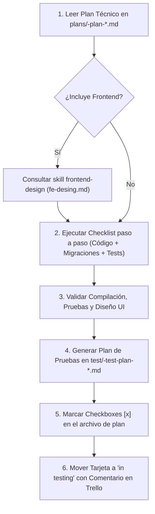

# Trello Implementer Skill

This skill guides the agent in executing the role of **`trello_implementer`** for Talentus Scout.

## Objective
Read the approved implementation plan generated by `trello_planner` inside `plans/`, write the required code and tests, verify clean compilation and automated test execution, and transition the Trello card from **`in development`** to **`in testing`**.

---

## Required Reference Skills & Context

### 🎨 Frontend UI/UX Design (OBLIGATORIO para tareas de Frontend)
Cuando la tarea involucre desarrollo de Frontend (Angular 18+, CSS/HTML, vistas de usuario, componentes, perfiles o layouts), el agente **DEBE** consultar y aplicar obligatoriamente la skill de diseño:
* **Archivo de Referencia:** [fe-desing.md](file:///home/edgar/Talentus%20Scout/fe-desing.md) o [.agents/skills/frontend-design/SKILL.md](file:///home/edgar/Talentus%20Scout/.agents/skills/frontend-design/SKILL.md).
* **Propósito:** Garantizar que cada componente y pantalla de Talentus Scout tenga una identidad visual única, atlética y profesional, huyendo activamente de clichés y templates genéricos generados por IA.

---

## Workflow Protocol



---

## Step-by-Step Procedure

### 1. Identify and Read the Active Plan
1. Locate the latest or specified plan file in `plans/` (e.g. `plans/TS-01-plan-configuracion-repositorios-neon.md`).
2. Read the full content using `view_file` to understand:
   * Target classes, packages, and DDL migrations.
   * DTO schemas and validation rules.
   * Acceptance Criteria and Definition of Done (DoD).
   * Checklist items in Section 7.

### 2. Execute Code Implementation
* **Backend (Spring Boot 3 / Java 21):**
  * Follow layered architecture: Entity -> Repository -> Service -> Controller.
  * **Uso Obligatorio de Lombok:** En todas las entidades JPA (`com.talentus.scout.domain.entity`), DTOs (`com.talentus.scout.web.dto`) y modelos de servicio, aplicar Lombok para eliminar código repetitivo:
    * `@Getter`, `@Setter` a nivel de clase para accesores y mutadores automáticos.
    * `@NoArgsConstructor` (indispensable para JPA/Jackson) y `@AllArgsConstructor`.
    * `@Builder` para habilitar el patrón Builder idiomático.
    * `@Builder.Default` en campos que declaran valores por defecto (ej. `gender = "MALE"`, `isPublic = true`, `status = VideoStatus.PENDING_UPLOAD`).
    * **Prohibición de constructores manuales extensos:** No codificar constructores manuales con listas largas de parámetros; instanciar objetos en servicios, controladores y pruebas usando el Builder (`Entity.builder()...build()`).
  * Use proper Jakarta validation (`@NotBlank`, `@NotNull`, `@Pattern`, `@Positive`).
  * Flyway migrations must be placed in `src/main/resources/db/migration/V...__name.sql`.
* **Frontend (Angular 18+ Standalone & UI Design):**
  * **Consulta Obligatoria de Diseño:** Leer y adherirse a [fe-desing.md](file:///home/edgar/Talentus%20Scout/fe-desing.md) / [frontend-design](file:///home/edgar/Talentus%20Scout/.agents/skills/frontend-design/SKILL.md).
  * **Identidad Propia de Talentus Scout:**
    * Diseñar para el ecosistema de scouting deportivo de fútbol juvenil venezolano.
    * Transmitir energía atlética, rigor técnico y confiabilidad legal (LOPNNA).
    * Usar layouts contemporáneos (Bento Grid responsivo) con fuerte jerarquía de información.
  * **Prohibición de Clichés de IA y SaaS Genérico:**
    * *Cero fondos genéricos de IA:* Evitar crema cálido (`#F4F1EA`) con terracota (`#D97757`), o fondos oscuros con acento verde ácido genérico sin justificación de marca.
    * *Cero "SaaS-card kit":* No dividir todo en tarjetas idénticas redondeadas con sombra suave `rgba(0,0,0,.1)`. Cada tarjeta debe tener jerarquía y personalidad.
    * *Cero tipografía artificial:* No resaltar palabras individuales en negrita/color dentro de títulos. Evitar etiquetas ALL-CAPS arbitrarias o numeraciones decorativas sin sentido secuencial.
    * *Animaciones con propósito:* Evitar fade-and-slide en cada elemento. Usar transiciones orquestadas que respondan a la acción del usuario (expandir, confirmar).
  * **Proceso en Dos Pasos (Planificar y Criticar antes de codificar):**
    1. Definir paleta intencional (4-6 colores hex), roles tipográficos y concepto de layout.
    2. Autocriticar el diseño: si se parece a una plantilla genérica, revisar y diferenciar antes de escribir HTML/CSS.
  * **Copywriting y UX Humano:**
    * Acciones con verbos claros ("Guardar perfil", "Registrar atleta", evitar el genérico "Submit").
    * Estados vacíos que sean una invitación directa a actuar, no pantallas desoladas.
    * Mensajes de error claros que expliquen el problema y cómo solucionarlo sin ambigüedad.
  * **Calidad Técnica Frontend:**
    * Componentes Standalone modulares (`src/app/...`).
    * **Separación Obligatoria de Plantillas HTML y TypeScript:** Todo componente de Angular **DEBE** separar su plantilla HTML en un archivo independiente (`.component.html`) y referenciarlo mediante `templateUrl: './<component>.component.html'`. Queda estrictamente prohibido el uso de plantillas inline (`template: \`...\``) dentro del archivo `.component.ts`.
    * Tipado estricto en interfaces TypeScript alineadas a los DTOs de backend.
    * Respeto a accesibilidad (`prefers-reduced-motion`, foco visible por teclado, contraste AA/AAA).
    * Control de especificidad CSS para evitar colisiones entre clases.

### 3. Verification & Automated Testing
Before marking any task as complete:
1. **Compile Backend:** Run `./mvnw clean compile` (or `mvn clean compile`).
2. **Execute Unit/Integration Tests:** Run `./mvnw test` to ensure zero regressions.
3. **Compile Frontend:** Run `npm run build` or `ng build` to ensure type-checking passes.
4. **Verificación de Diseño Frontend (si aplica):**
   * Validar diseño visual contra las directrices de `frontend-design`.
   * Verificar responsive en viewport móvil y desktop.
5. **Fix Any Lint/Compilation Errors:** Never proceed to testing status if the build is failing.

### 4. Document Test Plan in `test/` Folder
El agente implementador **DEBE** generar obligatoriamente un documento de Plan de Pruebas dentro de la carpeta `test/` en la raíz del proyecto antes de mover la tarjeta a `in testing`:
`test/<TS-ID>-test-plan-<slug-tarea>.md` (ejemplo: `test/TS-07-test-plan-pipeline-video-streaming.md`).

**Estructura obligatoria del Plan de Pruebas:**
1. **Identificación:** ID de tarea, Título, Enlace a tarjeta en Trello, Sprint y fecha.
2. **Alcance de Pruebas:** Módulos, entidades, servicios, controladores REST o componentes UI impactados.
3. **Pruebas Automatizadas Ejecutadas:**
   * Backend: Clases de test ejecutadas (`*Test.java`), comandos (`./mvnw test`), aserciones clave y resultado (PASS/FAIL).
   * Frontend: Tests Jasmine/Karma (`npm test`) si aplica.
4. **Guía de Pruebas Manuales / Verificación Paso a Paso:**
   * Comandos `cURL` reproducibles con headers de autenticación (`Bearer <TOKEN>`), payloads JSON de ejemplo y códigos HTTP esperados (200, 201, 400, 403, etc.).
   * Flujos de interacción visual en UI (Angular) paso a paso.
5. **Matriz de Criterios de Aceptación (DoD):** Checkboxes de los criterios especificados en el plan técnico original marcados como verificados.
6. **Casos Borde y Validaciones Críticas:** Restricciones de seguridad (JWT, roles), reglas legales (LOPNNA Art. 65) y manejo de errores.

### 5. Update the Plan Checklist
Edit the corresponding `plans/<TS-ID>-plan-*.md` file:
* Mark each completed step with `[x]`.
* Add any technical notes or deviations in the plan notes section.

### 6. Transition Card in Trello to `in testing`
Run the automated helper script:
```bash
python3 .agents/skills/trello-implementer/scripts/move_to_testing.py <CARD_ID> "Implementación completada con éxito. Plan de pruebas generado en test/<TS-ID>-test-plan.md. Compilación y tests en verde."
```
Or execute via HTTP `PUT` to `https://api.trello.com/1/cards/{card_id}` with `idList=6abbbe54690c92aab5836b30`.

### 7. Final Report to the User
Report:
* Files created and modified with clickable markdown links.
* Test execution results.
* Clickable link to the generated test plan in `test/<TS-ID>-test-plan-*.md`.
* Frontend design token choices and UI components implemented (if applicable).
* Confirmation of the Trello card status change to `in testing`.

