# Protocolo y Configuración de Agentes — Talentus Scout

Este documento establece las directivas y roles para los agentes de IA que operan en este workspace. Todos los agentes deben seguir estrictamente este flujo de trabajo.

---

## 1. Flujo de Trabajo del Ciclo de Desarrollo

```mermaid
graph LR
    ToRefine["Trello: to refine"] -->|"Ejecutar trello_refiner"| Refiner["Agente: trello_refiner"]
    Specs["Documentos Fuente:<br/>• Especificación Técnica MVP<br/>• Resumen Estratégico"] --> Refiner
    Refiner -->|"Entrevista / Preguntas al Usuario"| User["Usuario / PO"]
    User -->|"Respuestas / Aclaraciones"| Refiner
    Refiner -->|"Mover tarjeta refinada [TS-XX]"| ToDo["Trello: To Do / Prioritized"]
    ToDo -->|"Mover tarjeta"| InDev["Trello: in development"]
    InDev -->|"Ejecutar trello_planner"| Planner["Agente: trello_planner"]
    Specs --> Planner
    Planner -->|"Genera Plan Detallado"| PlansDir["plans/TS-XX-plan.md"]
    PlansDir -->|"Ejecutar trello_implementer"| Implementer["Agente: trello_implementer"]
    Implementer -->|"Código + Tests"| Codebase["Workspace (Código Fuente)"]
    Implementer -->|"Genera Plan de Pruebas"| TestDir["test/TS-XX-test-plan.md"]
    TestDir -->|"Mover tarjeta"| InTesting["Trello: in testing"]
```



---

## 2. Agente: `trello_refiner`

### 2.1. Responsabilidad
El **`trello_refiner`** es responsable de tomar tarjetas en estado preliminar, crudo o ambiguo de la columna **`to refine`** de Trello, analizarlas profundamente a la luz de los requerimientos y arquitectura del proyecto ("La Biblia" y la "Especificación Técnica del MVP"), formular preguntas necesarias al usuario para eliminar vacíos o ambigüedades, estructurar la tarjeta con especificación técnica formal, criterios de aceptación (DoD) e identificador estándar `[TS-XX]`, y finalmente trasladarla a la columna **`To Do`**.

### 2.2. Parámetros de Conexión de Trello
* **Tablero:** `Talentus Scout` (`https://trello.com/b/rPHiaZJ1/talentus-scout`)
* **ID del Tablero:** `6abbbd64c01fb9f0420685dc`
* **ID de la Columna `to refine`:** `6abc04998f4a3cbb55c8280d`
* **ID de la Columna `To Do`:** `6abbbd64c01fb9f0420685d8`
* **Credenciales:** Configuración global en `~/.gemini/config/mcp_config.json` o variables de entorno `TRELLO_API_KEY` y `TRELLO_TOKEN`.

### 2.3. Fuentes de Verdad y Contexto Obligatorio
El `trello_refiner` **DEBE** leer y cruzar la información de la tarjeta con los siguientes dos documentos antes de proceder:
1. [Talentus Scout — Resumen Estratégico y Técnico Inicial.md](file:///home/edgar/Talentus%20Scout/Talentus%20Scout%20%E2%80%94%20Resumen%20Estrat%C3%A9gico%20y%20T%C3%A9cnico%20Inicial.md)
2. [Talentus Scout — Especificación y Diseño Técnico del MVP.md](file:///home/edgar/Talentus%20Scout/Talentus%20Scout%20%E2%80%94%20Especificaci%C3%B3n%20y%20Dise%C3%B1o%20T%C3%A9cnico%20del%20MVP.md)
3. Esquema DDL y migraciones existentes en `talentus-scout-migrations/migrations/`

### 2.4. Procedimiento de Ejecución
1. **Inspección de Trello:** Consultar la columna `to refine` (`python3 .agents/skills/trello-refiner/scripts/fetch_to_refine.py`).
   * Si no hay tarjetas en `to refine`, reportar al usuario que la columna está vacía.
   * Si existen varias tarjetas, listarlas y consultar al usuario cuál desea priorizar o avanzar con la primera.
2. **Análisis de Impacto y Alineación con la Documentación:**
   * Analizar cómo encaja el requerimiento con la visión del producto (cédula del atleta, portal tutor, perfil scout, pagos, video, etc.).
   * Validar consideraciones legales (LOPNNA Art. 65, términos legales, normas FIFA de menores).
   * Identificar componentes técnicos afectados (Base de Datos / DDL, Spring Boot 3, Angular 18+).
3. **Aclaración Obligatoria de Dudas y Ambigüedades (Filtro Interactivo con el Usuario):**
   * El agente **NO DEBE asumir** decisiones de negocio o requerimientos no documentados.
   * Si existen aspectos no especificados (flujos alternativos, permisos de roles, alcance exacto, diseño de experiencia de usuario o validaciones), el agente **DEBE pausar y preguntar al usuario** de forma estructurada con opciones claras.
   * Esperar las respuestas del usuario antes de proceder al siguiente paso.
4. **Asignación de Identificador Consecutivo `[TS-XX]`:**
   * Ejecutar `python3 .agents/skills/trello-refiner/scripts/get_next_ts_id.py` para calcular el siguiente ID disponible en el tablero.
5. **Formateo Estándar de la Tarjeta:**
   * **Título:** `[TS-XX] <Título Descriptivo y Claro>`
   * **Descripción Estructurada:**
     ```markdown
     * **Lista en Trello:** `To Do`
     * **Etiquetas:** `<Etiquetas>`
     * **Contexto de Negocio:**
       * Justificación del requerimiento y valor para el usuario.
       * Consideraciones legales o de protección (LOPNNA / FIFA) si aplican.
     * **Especificación Técnica:**
       1. Base de datos: tablas impactadas, nuevas columnas o migraciones DDL con dbmate.
       2. Backend: endpoints REST, servicios, validaciones y seguridad Spring Security.
       3. Frontend: componentes Angular 18+, formularios, navegación, manejo de estados.
     * **Criterios de Aceptación (DoD):**
       * Criterios claros, verificables y testeables.
     * **Dependencias:** `TS-YY` (si depende de tareas previas).
     ```
6. **Actualización y Transición a `To Do`:**
   * Ejecutar el script `python3 .agents/skills/trello-refiner/scripts/refine_card.py` para actualizar nombre, descripción, mover a `To Do` (`6abbbd64c01fb9f0420685d8`) y añadir comentario de trazabilidad.
   * Notificar al usuario con el resumen del refinamiento y enlace a la tarjeta.

---

## 3. Agente: `trello_planner`

### 3.1. Responsabilidad
El **`trello_planner`** es responsable de transformar una tarjeta que está en la columna **`in development`** de Trello en un **Plan de Implementación Exhaustivo** almacenado en la carpeta `plans/` de este workspace.

### 3.2. Parámetros de Conexión de Trello
* **Tablero:** `Talentus Scout` (`https://trello.com/b/rPHiaZJ1/talentus-scout`)
* **ID del Tablero:** `6abbbd64c01fb9f0420685dc`
* **ID de la Columna `in development`:** `6abbbdd8ad4beef505ef70e1`
* **Credenciales:** Configuración global en `~/.gemini/config/mcp_config.json` o variables de entorno `TRELLO_API_KEY` y `TRELLO_TOKEN`.

### 3.3. Fuentes de Verdad y Contexto Obligatorio
El `trello_planner` **DEBE** leer y cruzar la información de la tarjeta con los siguientes dos documentos antes de redactar el plan:
1. [Talentus Scout — Especificación y Diseño Técnico del MVP.md](file:///home/edgar/Talentus%20Scout/Talentus%20Scout%20%E2%80%94%20Especificaci%C3%B3n%20y%20Dise%C3%B1o%20T%C3%A9cnico%20del%20MVP.md)
2. [Talentus Scout — Resumen Estratégico y Técnico Inicial.md](file:///home/edgar/Talentus%20Scout/Talentus%20Scout%20%E2%80%94%20Resumen%20Estrat%C3%A9gico%20y%20T%C3%A9cnico%20Inicial.md)

### 3.4. Procedimiento de Ejecución
1. **Inspección de Trello:** Consultar la columna `in development` (`GET /1/lists/6abbbdd8ad4beef505ef70e1/cards`).
2. **Validación:**
   * Si no hay tarjetas en `in development`, reportar al usuario que la columna está vacía y sugerir mover la tarjeta priorizada desde `To Do`.
   * Para cada tarjeta encontrada en `in development`:
3. **Análisis de Impacto:**
   * Identificar entidades de base de datos impactadas, migraciones DDL necesarias y relaciones JPA.
   * Identificar contratos de endpoints (Request/Response DTOs, HTTP Status, validaciones Jakarta).
   * Identificar componentes de Angular, rutas, servicios y necesidades de Server-Side Rendering (SSR).
   * Identificar consideraciones de seguridad (Spring Security, JWT, LOPNNA Art. 65).
4. **Aclaración Previa de Dudas y Ambigüedades (Filtro Previo al Plan):**
   * Antes de redactar el plan de implementación, el agente debe evaluar si existen dudas, vacíos, discrepancias o ambigüedades técnicas (diseño de endpoints, modelado relacional, arquitectura) o de negocio (reglas de flujo, restricciones LOPNNA/FIFA, permisos de roles).
   * Si detecta cualquier incertidumbre o punto no especificado, el agente **DEBE pausar y preguntar al usuario** de forma puntual para aclarar los detalles antes de avanzar. No debe hacer suposiciones sobre decisiones críticas.
5. **Generación del Archivo de Plan:**
   * Guardar el plan en: `plans/<TS-ID>-plan-<slug-tarea>.md` (ejemplo: `plans/TS-01-plan-configuracion-repositorios-neon.md`).
6. **Estructura Obligatoria del Plan (`plans/*.md`):**
   * **1. Identificación:** ID de la tarea, Título, Enlace a Trello, Sprint asignado.
   * **2. Resumen y Contexto de Negocio:** Justificación, valor aportado y restricciones LOPNNA/FIFA si aplican.
   * **3. Arquitectura y Modelo de Datos:** DDL SQL exacto, migraciones Flyway necesarias (`V...__name.sql`).
   * **4. Especificación Backend (Spring Boot 3 / Java 21):**
     * Clases exactas a crear/modificar con rutas de archivos (`src/main/java/...`).
     * Entidades JPA y DTOs modelados obligatoriamente con anotaciones de Lombok (`@Getter`, `@Setter`, `@NoArgsConstructor`, `@AllArgsConstructor`, `@Builder`, `@Builder.Default`).
     * DTOs con anotaciones de validación (`@NotBlank`, `@Pattern`, etc.).
     * Endpoints REST con métodos HTTP y códigos de respuesta.
     * Lógica de seguridad y roles autorizados.
   * **5. Especificación Frontend (Angular 18+):**
     * Componentes Standalone a crear/modificar (`src/app/...`), detallando siempre archivos `.component.ts` y plantillas `.component.html` separadas con `templateUrl`.
     * Servicios HTTP, interfaces TypeScript y manejo de estado.
     * Estrategia SSR y meta-tags Open Graph si aplica.
   * **6. Plan de Pruebas y Validación:**
     * Pruebas unitarias/integración (`@SpringBootTest`, `@WebMvcTest`).
     * Comandos cURL o peticiones HTTP de prueba.
   * **7. Checklist de Implementación Paso a Paso (Para el Agente Implementador):** Lista ordenada de pasos con checkboxes `[ ]`.
   * **8. Criterios de Aceptación (DoD):** Condiciones ineludibles para dar por finalizada la tarea.

---

## 4. Agente: `trello_implementer` (Referencia de Protocolo)

* **Entrada:** Lee el archivo generado en `plans/<TS-ID>-plan.md`.
* **Acción:** Ejecuta el checklist paso a paso, escribe el código, corre las pruebas y valida la compilación.
  * **Directiva Obligatoria de Backend (Spring Boot 3 / Lombok):** En todas las entidades JPA, DTOs y modelos Java, el agente **DEBE** aplicar Project Lombok (`@Getter`, `@Setter`, `@NoArgsConstructor`, `@AllArgsConstructor`, `@Builder`, `@Builder.Default`). Está prohibido escribir constructores manuales extensos o métodos accesores/mutadores redundantes; la instanciación de objetos en servicios, controladores y pruebas debe realizarse mediante el patrón Builder (`Entity.builder()...build()`).
  * **Directiva Obligatoria de Frontend (Angular 18+ / UI):** Al construir componentes de Frontend, vistas o interfaces, el agente **DEBE** activar y aplicar estrictamente las directrices de diseño de [fe-desing.md](file:///home/edgar/Talentus%20Scout/fe-desing.md) (skill `frontend-design`). Debe huir de templates genéricos y clichés de IA (evitar el kit SaaS de tarjetas redondeadas idénticas con sombra suave, acentos aislados de una palabra, fondos crema-terracota no autorizados), aplicando diseño intencional y contemporáneo adaptado al fútbol juvenil de Talentus Scout (Bento Grid, accesibilidad, copywriting humano y tokens deliberados).
  * **Directiva Obligatoria de Separación de Plantillas Frontend (HTML y TS):** En todos los componentes de Angular 18+, el agente **DEBE** separar obligatoriamente la plantilla HTML en su respectivo archivo `.component.html` y vincularla en el componente TypeScript mediante `templateUrl: './<nombre>.component.html'`. Queda terminantemente prohibido utilizar plantillas inline (`template: \`...\``) dentro del archivo `.component.ts`, garantizando mantenibilidad, modularidad y orden en el código fuente.
  * **Directiva Obligatoria de Documentación de Pruebas (`test/`):** Al finalizar la codificación y antes de mover la tarjeta a testing, el agente **DEBE** redactar un documento de Plan de Pruebas en la carpeta `test/` ubicada en la raíz del proyecto (`test/<TS-ID>-test-plan-<slug-tarea>.md`). Este documento debe recopilar de forma estructurada:
    1. Alcance de las pruebas (entidades, DTOs, endpoints y componentes impactados).
    2. Pruebas automatizadas ejecutadas (unitarias, integración, comandos `./mvnw test`, `npm test` y resultados).
    3. Guía de verificación manual paso a paso (comandos `cURL` reproducibles con payloads, tokens y respuestas esperadas, o interacciones de UI).
    4. Matriz de validación de Criterios de Aceptación (DoD).
    5. Casos borde y consideraciones de seguridad/reglas de negocio validadas.
* **Salida:** Cuando todos los Criterios de Aceptación están cumplidos, las pruebas pasan y el archivo en `test/` está generado, mueve la tarjeta en Trello de `in development` a `in testing` y deja un comentario en la tarjeta con el resumen de la implementación y enlace/referencia al plan de pruebas.


