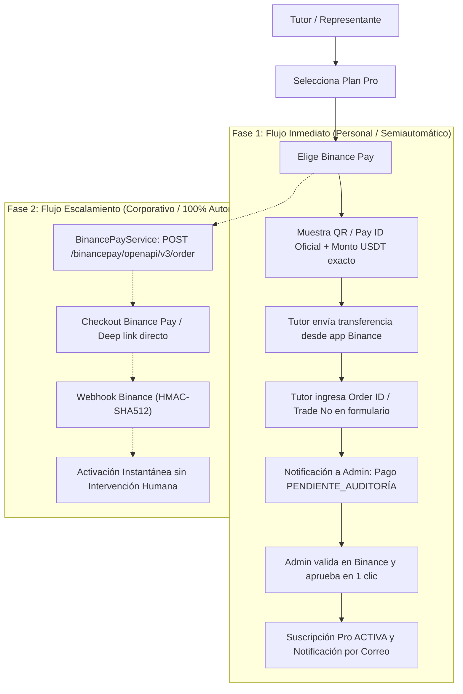

# Guía Administrativa y Operativa: Pasarelas de Pago Internacionales y Binance Pay

**Proyecto:** Talentus Scout  
**Documento Técnico-Operativo:** Spike TS-50  
**Fecha:** Octubre 2026  
**Audiencia:** Equipo Fundador, Directores de Operaciones y Equipo Técnico  
**Estado:** OFICIAL / APROBADO  

---

## 1. Resumen Ejecutivo y Contexto de Negocio

Talentus Scout es una plataforma de scouting deportivo enfocada en visibilizar el talento del fútbol juvenil venezolano ante cazatalentos internacionales, clubes y academias. La monetización del servicio reside en suscripciones a planes **Talentus Pro** (mensual y anual) contratados por los tutores legales de los futbolistas.

### El Reto de Pagos
Una proporción sustancial de tutores y familiares de los atletas reside en el exterior (Chile, Estados Unidos, España, Colombia, Perú, etc.) o maneja activos financieros fuera del sistema bancario venezolano:
1. **Cobros en Bolívares (VES):** El sistema ya cuenta con conciliación de **Pago Móvil** conectada al tipo de cambio oficial del BCV.
2. **Cobros en Divisas (USD):** Se requiere admitir tarjetas internacionales de débito/crédito (Visa, Mastercard, American Express) y criptoactivos estables (USDT vía Binance Pay).
3. **Restricción Geográfica y Administrativa:** Stripe no admite apertura directa de cuentas bancarias en Venezuela ni Chile para personas naturales/jurídicas locales estándar. Asimismo, la cuenta de Binance disponible para los fundadores es de carácter personal, lo que restringe el acceso inmediato a la API de comercios (Merchant API).

El presente documento establece el diagnóstico legal, tributario, financiero y técnico para habilitar ambos canales con máxima eficiencia de costes y seguridad.

---

## 2. Evaluación de Pasarelas para Tarjetas de Crédito/Débito Internacionales

Para procesar pagos internacionales con tarjeta de tutores en cualquier parte del mundo, se evaluaron cuatro alternativas principales organizadas en dos rutas estructurales:
* **Ruta Norteamericana:** Constitución de persona jurídica en EE.UU. para operar con **Stripe Global**.
* **Ruta Sudamericana:** Utilización de persona jurídica en **Chile** (donde los fundadores tienen presencia y capacidad operativa) para operar pasarelas cross-border o locales.

---

### 2.1. Opción 1: Stripe Global vía Stripe Atlas (LLC en EE.UU.)

Stripe Atlas permite a emprendedores no residentes en EE.UU. constituir una sociedad de responsabilidad limitada (**LLC**) en Delaware o Wyoming de forma digital y paquetizada.

* **Estructura Corporativa:**
  - LLC de un solo miembro o multimiembro en Delaware o Wyoming.
  - Asignación de Tax ID federal (**EIN**) por el IRS.
  - Apertura de cuenta bancaria corporativa digital en USD (**Mercury Bank**, Brex o Novo).
* **Costes Iniciales y Recurrentes:**
  - Costo de constitución (Stripe Atlas): **$500 USD** (pago único, incluye tasas estatales iniciales y primer año de agente registrado).
  - Tasa anual estatal (Franchise Tax): **$300 USD/año** (Delaware) o **$60 USD/año** (Wyoming).
  - Agente Registrado anual: **$100 - $150 USD/año** (a partir del 2do año).
  - Declaración tributaria anual para extranjeros (Formularios IRS 5472 y 1120): **$300 - $600 USD/año** (vía plataformas contables como doola o contadores certificados).
* **Comisiones de Procesamiento Stripe:**
  - **2.9% + $0.30 USD** por cobro exitoso con tarjetas domésticas de EE.UU.
  - **+1.5%** por tarjetas internacionales emitidas fuera de EE.UU.
  - **+1.0%** si se requiere conversión de divisa.
* **Liquidación (Payouts):** 2 días hábiles (rolling basis) directo a la cuenta Mercury en USD.
* **Ventajas:**
  - Aceptación universal con la menor tasa de fricción o rechazo bancario a nivel mundial.
  - Precios fijados y cobrados en USD exactos, sin variaciones cambiarias para tutores.
  - Soporte de Apple Pay, Google Pay y Link nativos.
* **Desventajas:**
  - Carga burocrática y fiscal anual en EE.UU. que debe mantenerse independientemente del volumen de ventas.

---

### 2.2. Opción 2: dLocal Go (Empresa en Chile)

dLocal Go es una solución fintech enfocada en pagos transfronterizos para empresas de Latinoamérica, permitiendo recibir pagos internacionales y liquidar en divisas o moneda local.

* **Requisitos:** Empresa constituida en Chile (SpA o SRL) con RUT de empresa y representante legal con RUT chileno.
* **Coste de Setup:** **$0 USD** (sin costes fijos mensuales).
* **Comisiones de Procesamiento:**
  - **4.0% a 4.9% + $0.30 USD** por transacción internacional procesada.
* **Moneda de Cobro y Liquidación:**
  - Permite configurar precios en USD en el checkout.
  - Liquidación en USD (hacia cuenta bancaria en USD) o en CLP (con conversión a tipo de cambio interbancario de dLocal).
* **Ventajas:**
  - Cero costes fijos de mantenimiento corporativo en el exterior.
  - API moderna y checkout embebido/redirección simple.
* **Desventajas:**
  - Comisión por transacción significativamente más alta que Stripe.
  - Proceso de validación de negocio (KYB) riguroso para plataformas deportivas/menores.

---

### 2.3. Opción 3: Flow.cl / Webpay Plus de Transbank (Empresa en Chile)

Flow es uno de los integradores de pagos más consolidados de Chile, con soporte para Webpay Plus (Transbank), Servipag y tarjetas de crédito/débito internacionales.

* **Requisitos:** Persona jurídica (SpA) con RUT chileno y cuenta bancaria en Chile (CLP).
* **Coste de Setup:** **$0** (sin coste fijo mensual).
* **Comisiones de Procesamiento:**
  - Tarjetas extranjeras: **3.19% + IVA** (~3.8% total por transacción).
* **Manejo de Divisas:**
  - **Crítico:** Flow y Transbank operan contablemente en **Pesos Chilenos (CLP)**.
  - Para cobrar un plan de $15 USD o $120 USD, la plataforma debe cotizar el equivalente en CLP al momento del checkout. El tutor en el exterior verá un cargo en pesos chilenos que su banco emisor convertirá a la moneda de su tarjeta, introduciendo potenciales comisiones bancarias por cambio de divisa al usuario.
* **Ventajas:**
  - Activación inmediata (24 a 48 horas con empresa chilena).
  - SDKs y plugins sumamente estables.
* **Desventajas:**
  - Pérdida de la referencia fija en USD; fricción visual para tutores que pagan desde EE.UU., España o Venezuela al ver un checkout en CLP.

---

### 2.4. Opción 4: Mercado Pago Chile

* **Comisiones:** ~3.19% + IVA para tarjetas locales y extranjeras.
* **Limitación Principal:** Presenta tasas de rechazo elevadas (fraude/scoring estricto) cuando las tarjetas fueron emitidas en bancos venezolanos (tarjetas internacionales Bancamiga, Banesco, etc.) o de jurisdicciones fuera del cono sur.

---

### 2.5. Matriz Comparativa Multidimensional

| Criterio | Stripe Atlas (EE.UU.) | dLocal Go (Chile) | Flow.cl / Transbank (Chile) | Mercado Pago (Chile) |
|---|---|---|---|---|
| **Costo Inicial de Setup** | ~$500 USD | **$0 USD** | **$0 USD** | **$0 USD** |
| **Costos Fijos Anuales** | ~$400 - $750 USD (tax/agent) | **$0 USD** | **$0 USD** | **$0 USD** |
| **Comisión por Tarjeta Extranjera** | 2.9% + $0.30 (+1.5% int.) | 4.5% + $0.30 USD | **~3.8% (IVA incl.)** | ~3.8% (IVA incl.) |
| **Cobro Nativo en USD** | **SÍ (Directo)** | **SÍ (Directo)** | NO (Requiere CLP) | NO (Requiere CLP) |
| **Desembolso (Payouts)** | 2 días (USD a Mercury) | 7 a 14 días (USD o CLP) | 1 a 3 días (CLP en Chile) | 1 a 14 días (CLP) |
| **Fricción / Tasa de Aprobación** | **Excelente (>95%)** | Muy Buena (>85%) | Media para foráneas (~75%) | Baja para foráneas (~65%) |
| **Tiempo de Puesta en Marcha** | 2 a 3 semanas | 1 a 2 semanas | **3 a 5 días** | 3 a 5 días |
| **Experiencia de Usuario** | Stripe Elements / Hosted | Checkout Hosted | Webpay / Portal Flow | Checkout Pro |

---

### 2.6. Recomendación Estratégica: Estrategia Progresiva (Ruta Bimodal)

Para optimizar el flujo de caja de Talentus Scout y evitar incurrir en $900 USD de gastos legales/fiscales antes de validar tracción de ventas, se recomienda la siguiente **Ruta Bimodal**:

1. **Fase 1 (Inmediata / Lanzamiento MVP):**
   * Operar mediante la empresa en **Chile** integrando **dLocal Go** o **Flow.cl**:
     - Si se prioriza mantener el precio puramente en USD: **dLocal Go**.
     - Si se prioriza inmediatez de cobro y menor comisión: **Flow.cl** con cotización automática USD/CLP.
2. **Fase 2 (Escalamiento / Tracción Validada):**
   * Una vez alcanzados los primeros 100 suscriptores Pro activos, constituir la LLC con **Stripe Atlas** en Wyoming o Delaware, migrando el checkout de backend a Stripe para maximizar la conversión global y abrir puertas a fondos de capital o aceleradoras internacionales.

---

## 3. Diagnóstico y Estrategia para Binance Pay Productivo

### 3.1. Requisitos Oficiales de Binance Pay Merchant API
La API de comercio de Binance (`https://bpay.binanceapi.com/binancepay/openapi/...`) permite:
- Generar órdenes de pago con QR y deep-links nativos (`binancepay://pay?...`).
- Expiración automática de transacciones en 15-30 minutos.
- Emisión de Webhooks con firma criptográfica simétrica HMAC-SHA512 para activación desasistida de suscripciones.

**Condición Obligatoria de Binance:** La generación de credenciales productivas (`merchantId`, `apiKey` y `secretKey`) exige acceder a la consola **Binance Merchant**, la cual **únicamente está habilitada para Cuentas Corporativas/Institucionales (Enterprise KYB)**. Las cuentas de persona natural (KYC personal) no disponen de panel de desarrollador para Webhooks oficiales ni emisión de claves merchant.

---

### 3.2. Estrategia de Implementación en Dos Fases para Binance Pay

Dado que el equipo fundador cuenta actualmente con una **cuenta personal verificada**, se diseña la siguiente arquitectura operativa:



#### Fase 1: Mecanismo Inmediato de Pago Semiautomatizado (MVP)
* **Cómo funciona en el frontend:**
  1. En el checkout de pago (`/payments`), al seleccionar "Binance Pay", la interfaz despliega una tarjeta bento elegante con:
     - El **Binance Pay ID oficial** de Talentus Scout (asociado a la cuenta personal verificada del fundador).
     - Un código QR dinámico con la imagen oficial de Binance Pay.
     - El monto exacto a transferir en USDT (ej. $15.00 USDT o $120.00 USDT).
     - Un campo para ingresar el **Número de Orden de Binance Pay (Order ID / Pay ID)** de la transacción realizada por el tutor.
  2. Al presionar "Registrar Pago", el backend registra la transacción con `method = BINANCE_PAY`, `status = PENDING_AUDIT`.
  3. El panel de administración (`/admin/pagos`), que ya cuenta con todo el flujo de auditoría y aprobación implementado en `AdminPaymentController`, permite al administrador cotejar el Order ID en su app de Binance y aprobar la transacción con un solo clic.
  4. Al aprobar, el servicio activa automáticamente la suscripción del menor y dispara el correo transaccional de bienvenida al tutor.

#### Fase 2: Transición a Binance Merchant API (Productivo 100% Automatizado)
* **Cómo funciona:**
  - Una vez registrada la empresa (en Chile o EE.UU.), se realiza el registro corporativo en Binance Institutional (trámite 100% online que demora entre 5 y 10 días).
  - Se obtienen las credenciales oficiales de producción en el portal `merchant.binance.com`.
  - El backend de Talentus Scout **ya cuenta con el código completo y testeado** en `BinancePayService.java` (`createOrder` y `handleWebhook` con HMAC-SHA512). Simplemente se actualizan las variables de entorno en producción:
    ```bash
    TALENTUS_PAYMENTS_BINANCE_PAY_API_KEY=<PROD_API_KEY>
    TALENTUS_PAYMENTS_BINANCE_PAY_SECRET_KEY=<PROD_SECRET_KEY>
    TALENTUS_PAYMENTS_BINANCE_PAY_MERCHANT_ID=<PROD_MERCHANT_ID>
    TALENTUS_PAYMENTS_BINANCE_PAY_SANDBOX=false
    ```

---

## 4. Checklist de Trámites Administrativos, Legales y Fiscales

### A. Para el Equipo Fundador (Ruta Empresa en Chile)
- [ ] **Constitución y RUT:** Verificar la vigencia de la sociedad (SpA) y el RUT de la empresa emitido por el Servicio de Impuestos Internos (SII).
- [ ] **Giro Comercial:** Asegurar que el giro incluya servicios informáticos, portales web o actividades deportivas/publicitarias.
- [ ] **Cuenta Bancaria:** Disponer de cuenta corriente empresarial en pesos chilenos (CLP) o cuenta bimonetaria (CLP/USD).
- [ ] **Alta en Pasarela:**
  - Si dLocal Go: Registro en `dlocalgo.com` adjuntando e-RUT y cédula del representante legal.
  - Si Flow.cl: Registro en `flow.cl`, validación de datos bancarios y firma de contrato de adhesión digital.

### B. Para la Activación de Binance Pay
- [ ] **Fase 1 (Inmediata):**
  - Generar el Binance Pay ID en la app de Binance personal.
  - Descargar el código QR oficial de recepción de fondos en USDT.
  - Configurar en las variables de aplicación el ID y QR para desplegar a los tutores.
- [ ] **Fase 2 (Corporativa):**
  - Ingresar a `https://www.binance.com/es/institutions`.
  - Completar el formulario de verificación KYB con estatutos de la empresa, RUT y certificado de vigencia.
  - Solicitar acceso a Binance Pay Merchant y registrar la URL de webhook:
    `https://api.talentus.app/api/v1/payments/binance-pay/webhook`

---

## 5. Tarjetas Técnicas Derivadas para el Backlog de Trello

Como resultado de este Spike, se definen dos tareas de implementación desacopladas y prioritarias:

### 1. `[TS-51] Integración de Pasarela de Pago Internacional para Tarjetas de Crédito/Débito`
* **Tipo:** Feature / Fullstack
* **Objetivo:** Conectar el checkout de tutores con la pasarela internacional seleccionada (dLocal Go o Stripe), permitiendo ingresar tarjeta de forma segura, recibir webhooks de pago confirmado y activar la suscripción del atleta automáticamente.
* **Componentes:**
  - Backend: `CardPaymentService`, endpoint `/api/v1/payments/card/checkout`, webhook `/api/v1/payments/card/webhook`.
  - Frontend: Componente de checkout con selector de tarjeta, integración de iframe o redirect seguro, pantalla de éxito/error.

### 2. `[TS-52] Configuración y Pase a Producción de Binance Pay y Flujo Semiautomático con Pay ID`
* **Tipo:** Feature / Fullstack
* **Objetivo:** Habilitar el flujo de cobro inmediato con Binance Pay ID y QR para tutores, con captura del Order ID, y configurar las variables productivas para la transición a Merchant API.
* **Componentes:**
  - Frontend: Vista modal/checkout con Binance Pay ID, código QR descargable, campo de entrada de referencia y botón de confirmación.
  - Backend: Endpoint para registro de pago con Binance Pay manual (`status = PENDING_AUDIT`), soporte en el panel administrativo y parametrización de variables de entorno productivas de `BinancePayService`.
