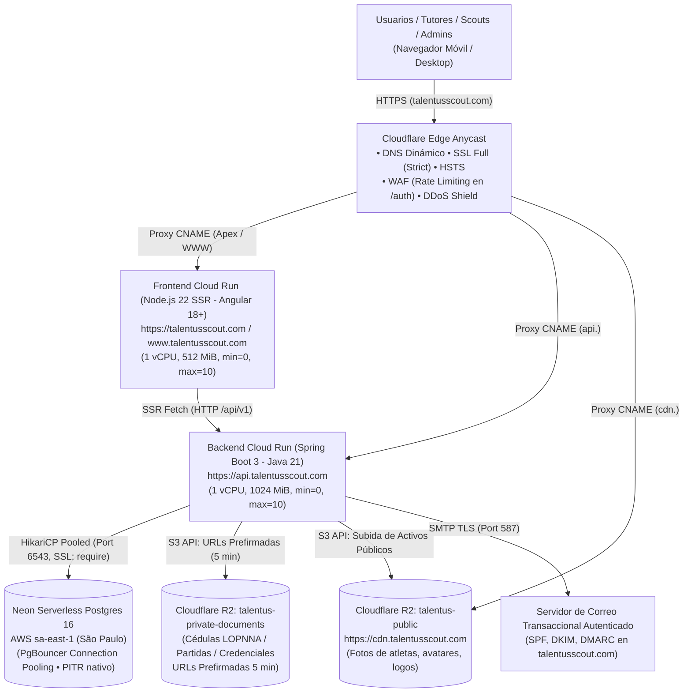

# Plan de Despliegue en la Nube — Entorno de Producción (Go-Live MVP — Modo Ahorro)
## Talentus Scout

**Versión:** 2.1.0 (Producción Go-Live / Modo Ahorro Lean)  
**Fecha:** 23 de octubre de 2026  
**Ubicación:** `docs/PLAN_DESPLIEGUE_NUBE_AMBIENTE_PRUEBAS.md` (y `docs/PLAN_DESPLIEGUE_NUBE_PRODUCCION.md`)  
**Estado:** LISTO PARA EJECUCIÓN (PRODUCCIÓN INICIAL)  

---

## 1. Resumen Ejecutivo y Filosofía de Lanzamiento en "Modo Ahorro"

El objetivo de este plan es orquestar la subida del ecosistema completo de **Talentus Scout** directamente a **Producción Real (Go-Live)** para usuarios finales (tutores, atletas, scouts y administradores), pero operando bajo una estricta estrategia de **Modo Ahorro / Lean**.

Esta modalidad permite abrir la plataforma comercialmente con costo operativo mensual de **$0.00 USD** (aprovechando al 100% las capas gratuitas de GCP Cloud Run, Neon Serverless Postgres y Cloudflare), eliminando tareas complejas de mantenimiento, sondas artificiales que despierten instancias innecesariamente y servicios periféricos de pago o sobrecarga, difiriendo dichos componentes para la fase de tracción y escalamiento.

### Premisas del Modo Ahorro en Producción:
1. **Infraestructura Serverless con Autoescalado a Cero (`min-instances=0`):** Tanto Backend como Frontend duermen cuando no hay tráfico, consumiendo 0 vCPU y 0 RAM. Cuando entra un usuario, Cloud Run despierta la instancia en pocos segundos gracias a *Startup CPU Boost*.
2. **Sin Sondas Ni Pings Periódicos (Evitar Despertares Artificiales):** Se prescinde deliberadamente de monitores externos continuos (UptimeRobot / BetterStack) y probes de Actuator en reposo para que las instancias permanezcan apagadas mientras no haya interacción real de usuarios, conservando intacta la cuota mensual de GCP Always Free.
3. **Persistencia Inicial con Neon PITR:** Se utiliza la durabilidad y redundancia nativa de Neon Postgres junto con su capacidad de *Point-In-Time Recovery (PITR)* incluida en la capa gratuita, postergando la creación de buckets de dumps diarios y scripts automáticos de exportación a R2.
4. **Seguridad y Cumplimiento Legal No Negociables:**
   * Certificados SSL/TLS en modo **Full (Strict)**, HSTS y WAF con mitigación de ataques de fuerza bruta en autenticación.
   * Protección integral de datos de menores (**LOPNNA Art. 65**): Cédulas y partidas de nacimiento almacenadas en bucket privado de Cloudflare R2 con acceso exclusivo mediante URLs prefirmadas de 5 minutos generadas bajo demanda.
   * Supresión absoluta de trazas de depuración (*stacktraces*), endpoints de mock y credenciales de desarrollo.
5. **Flujos Financieros Seguros:** Pago Móvil y Binance Pay P2P con validación de unicidad de referencias bancarias en base de datos (antifraude) y panel de auditoría administrativa.

---

## 2. Mapa de Arquitectura y Topología en Modo Ahorro



---

## 3. Matriz de Componentes y Asignación de Recursos (Modo Ahorro)

| Componente | Proveedor / Servicio | Región / Zona | Configuración Inicial | Plan / Capacidad | Costo Estimado |
| :--- | :--- | :--- | :--- | :--- | :---: |
| **Dominio Comercial** | Namecheap | Global | `talentusscout.com` + `www` + subdominios | Registro anual con WhoisGuard | ~$10 – $12 / año |
| **Borde, DNS, WAF, SSL** | Cloudflare | Anycast Global | SSL Full Strict, HSTS, Rate Limiting en `/auth`, Bot Fight | Free Plan | **$0.00** |
| **Frontend SSR** | GCP Cloud Run | `southamerica-east1` (São Paulo) | Node 22 SSR, 1 vCPU, 512 MiB, `min=0`, `max=10`, Startup CPU Boost | Capa Always Free | **$0.00** |
| **Backend API REST** | GCP Cloud Run | `southamerica-east1` (São Paulo) | Spring Boot 3, 1 vCPU, 1024 MiB, `JAVA_OPTS`, `min=0`, `max=10`, Startup Boost | Capa Always Free | **$0.00** |
| **Base de Datos Relacional** | Neon Serverless Postgres | AWS `sa-east-1` (São Paulo) | PostgreSQL 16 con PgBouncer, pooling HikariCP optimizado | Free Tier (0.5 GiB, 1 proyecto) | **$0.00** |
| **Almacenamiento Público** | Cloudflare R2 | Global (S3 API) | Bucket `talentus-public` (`cdn.talentusscout.com`), Cache-Control 1 día | Free Tier (10 GB gratis, 0 egreso) | **$0.00** |
| **Almacenamiento Privado** | Cloudflare R2 | Global (S3 API) | Bucket `talentus-private-documents` (LOPNNA, URLs prefirmadas) | Free Tier (Compartido) | **$0.00** |
| **Secretos y Credenciales** | GCP Secret Manager | `southamerica-east1` | Versiones activas con llaves criptográficas de 512-bits | Capa gratuita (6 versiones gratis) | **~$0.00** |
| **Registro de Contenedores** | GCP Artifact Registry | `southamerica-east1` | Repositorio Docker estándar `talentus-containers` | 0.5 GB gratis (~$0.10 si excede) | **~$0.00** |
| **Email Transaccional** | SMTP / Proveedor Dedicado | Global | Autenticación SPF, DKIM, DMARC en `talentusscout.com` | Google Workspace o Resend Free | **$0.00** |
| **CI/CD Automatizado** | GitHub Actions | Ubuntu Cloud | Workflows de migraciones y despliegue a Cloud Run | 2.000 min/mes incluidos | **$0.00** |

---

## 4. Hardening de Código y Ajustes Técnicos de Producción

### 4.1. Almacenamiento Persistente en Cloudflare R2 (`R2FileStorageService`)
* **Dependencia Oficial:** Incorporar `software.amazon.awssdk:s3:2.25.+` en `talentus-scout-be/pom.xml`.
* **Implementación de Servicio:** Implementar `R2FileStorageService` activado por el perfil `prod` (`talentus.storage.provider=r2`).
* **Seguridad Estricta en Archivos:**
  * **Público (`talentus-public`):** Almacena fotos de perfil, imágenes de atletas y logos de clubes deportivos. URLs expuestas bajo `https://cdn.talentusscout.com/{key}`.
  * **Privado LOPNNA (`talentus-private-documents`):** Almacena cédulas de tutores, partidas de nacimiento de atletas y credenciales de scouts. Acceso **únicamente** a través del método `generatePresignedUrl(String key, Duration expiration)` con una validez estricta de **5 minutos** (`Duration.ofMinutes(5)`), verificando previamente en el controlador que el usuario solicitante posea rol `ROLE_ADMIN` o sea el tutor legal asociado al atleta.
* **Retiro de Endpoint Inseguro:** Eliminar o proteger con autenticación el mapeo permisivo de `/uploads/**` en producción.

### 4.2. Perfil de Producción Backend (`application-prod.yml`)
Debe crearse `talentus-scout-be/src/main/resources/application-prod.yml` con las siguientes directivas:

```yaml
spring:
  config:
    activate:
      on-profile: prod
  datasource:
    url: jdbc:postgresql://${DB_HOST}:${DB_PORT}/${DB_NAME}?sslmode=require&prepareThreshold=0
    username: ${DB_USER}
    password: ${DB_PWD}
    hikari:
      maximum-pool-size: 10
      minimum-idle: 1
      connection-timeout: 30000
      idle-timeout: 600000
      max-lifetime: 1800000
      keepalive-time: 30000
      connection-test-query: SELECT 1
  jpa:
    show-sql: false
    hibernate:
      ddl-auto: validate
  # Servicio de Correo Transaccional con Resend API
talentus:
  mail:
    enabled: ${MAIL_ENABLED:true}
    from: ${MAIL_FROM:contacto@talentusscout.com}
    api-key: ${RESEND_API_KEY}

server:
  port: ${PORT:8080}
  error:
    include-stacktrace: never
    include-message: never
    include-binding-errors: never

management:
  endpoints:
    web:
      exposure:
        include: health,info
  endpoint:
    health:
      show-details: when_authorized

security:
  jwt:
    secret-key: ${JWT_SECRET_KEY}
    expiration-time: 86400000 # 24 horas

talentus:
  storage:
    provider: r2
    r2:
      endpoint: ${R2_ENDPOINT}
      access-key: ${R2_ACCESS_KEY_ID}
      secret-key: ${R2_SECRET_ACCESS_KEY}
      public-bucket: talentus-public
      private-bucket: talentus-private-documents
      cdn-base-url: https://cdn.talentusscout.com
  video:
    enabled: ${VIDEO_FEATURE_ENABLED:false}
  frontend:
    base-url: https://talentusscout.com
    certify-url: https://talentusscout.com/certify
```

### 4.3. Dimensionamiento y Parámetros en Cloud Run (Modo Ahorro)
* **Backend:**
  * CPU: 1 vCPU
  * Memoria: **1024 MiB (1 GiB)**
  * **Flags JVM:** `JAVA_OPTS="-Xms512m -Xmx800m -XX:+UseG1GC -XX:+ExitOnOutOfMemoryError"`
  * **Startup CPU Boost:** Habilitado (reduce el arranque en frío inicial a ~6-8 segundos).
  * **Instancias:** Mínimo `0` (ahorro total en reposo), Máximo `10`.
  * **Arranque:** Verificación estándar de Cloud Run en puerto HTTP 8080 (sin probes personalizados continuos).
* **Frontend:**
  * CPU: 1 vCPU
  * Memoria: 512 MiB
  * Instancias: Mínimo `0`, Máximo `10`.
  * Puerto del contenedor: 4000.

### 4.4. Frontend SSR: Contenedor Puro Node.js 22
Se retira Nginx para el despliegue en Cloud Run, adoptando una imagen oficial optimizada multi-stage con Node.js 22 Alpine:

```dockerfile
# talentus-scout-fe/Dockerfile.prod
FROM node:22-alpine AS builder
WORKDIR /app
COPY package*.json ./
RUN npm ci --prefer-offline --no-audit
COPY . .
RUN npm run build -- --configuration=production

FROM node:22-alpine AS runner
WORKDIR /app
ENV NODE_ENV=production
ENV PORT=4000
COPY --from=builder /app/dist/talentus-scout-fe /app/dist/talentus-scout-fe
USER node
EXPOSE 4000
CMD ["node", "/app/dist/talentus-scout-fe/server/server.mjs"]
```

* **Variables en Frontend:**
  * `PORT=4000`
  * `NODE_ENV=production`
  * `BACKEND_INTERNAL_URL=https://api.talentusscout.com`
* **Entorno de Producción (`environment.prod.ts`):**
  ```typescript
  export const environment = {
    production: true,
    apiBaseUrl: 'https://api.talentusscout.com/api/v1',
    backendOrigin: 'https://api.talentusscout.com',
    googleClientId: '',
    microsoftClientId: '',
    microsoftRedirectUri: 'https://talentusscout.com/auth/login'
  };
  ```

### 4.5. Módulo de Pagos en Producción (Pago Móvil & Binance Pay P2P)
* **Validación de Unicidad Antifraude:** La tabla SQL `payment_transactions` **DEBE** poseer restricción `UNIQUE` sobre `reference_number` y `transaction_hash`. Esto impide que dos usuarios reporten la misma referencia o reutilicen comprobantes.
* **Alertas Administrativas:** Al recibirse un pago en estado `PENDING_AUDIT`, el backend despacha un correo de alerta a `pagos@talentusscout.com` para que el equipo financiero audite el depósito desde `/admin/pagos`.
* **Notificación al Tutor:** Una vez auditado el pago, se envía un correo automático al tutor confirmando la activación de la Ficha Técnica o detallando el motivo del rechazo.
* **Tasa de Cambio Oficial (BCV):** Integración con la API del Banco Central de Venezuela con almacenamiento en caché (TTL 6 horas) y tasa de fallback para calcular el monto en Bolívares (VES).

### 4.6. Módulo de Video (Estrategia MVP Go-Live)
* Para el lanzamiento inicial a producción (Fase 1), el Feature Flag `VIDEO_FEATURE_ENABLED` se mantiene en `false` por defecto:
  * El Backend rechaza cargas de video con HTTP 503 (`Módulo de Video programado para Fase 2`).
  * El Frontend oculta la zona de carga y despliega un banner estilizado con Bento Grid informando: *"Próximamente disponible: Carga de jugadas destacadas en video HD"*.
  * Cero costos de almacenamiento de video y ancho de banda durante el lanzamiento inicial.

---

## 5. Guía de Aprovisionamiento y Configuración de Servicios

### Paso 1: Dominio Comercial y Configuración de Cloudflare
1. **Namecheap:** Registrar `talentusscout.com`.
2. **Cloudflare:**
   * Agregar el sitio `talentusscout.com` (Plan Free).
   * Reemplazar los Nameservers en Namecheap por los provistos por Cloudflare.
   * **SSL/TLS:** Configurar en modo **Full (Strict)**.
   * **Edge Certificates:** Habilitar **Always Use HTTPS**, **Automatic HTTPS Rewrites**, **TLS 1.3** y **HSTS** (max-age 1 año, include subdomains, preload).
   * **Page Rules / Redirect Rules:** Redirección 301 de `https://www.talentusscout.com/*` hacia `https://talentusscout.com/$1`.
   * **Seguridad WAF / Rate Limiting:**
     * URI Path contiene `/api/v1/auth/` -> Limitar a 5 peticiones por minuto por IP.
     * Habilitar **Bot Fight Mode**.

### Paso 2: Aprovisionamiento de Cloudflare R2 (2 Buckets)
1. En la consola de Cloudflare, navegar a **R2**.
2. Crear los 2 buckets iniciales requeridos:
   * `talentus-public`: Acceso público habilitado vinculado al dominio personalizado `cdn.talentusscout.com`.
   * `talentus-private-documents`: Acceso público **deshabilitado**. Solo accesible vía API S3 mediante URLs prefirmadas.
3. Generar un **API Token de R2**:
   * Permisos: *Object Read & Write* sobre los dos buckets de Talentus Scout.
   * Copiar: `Account ID`, `Access Key ID`, `Secret Access Key` y Endpoint S3 (`https://<account-id>.r2.cloudflarestorage.com`).

### Paso 3: Base de Datos en Neon (PostgreSQL 16)
1. Iniciar sesión en **Neon.tech** (Plan Free).
2. Crear el proyecto de producción:
   * Nombre: `talentus-scout-prod`
   * Región: **AWS sa-east-1 (São Paulo)**.
   * Versión: **PostgreSQL 16**.
3. Copiar las cadenas de conexión:
   * **Pooled Connection (Puerto 6543, PgBouncer):** Para el Backend Spring Boot.
   * **Direct Connection (Puerto 5432):** Para las migraciones con `dbmate`.
4. La capa gratuita de Neon provee durabilidad en storage y *Point-in-Time Recovery (PITR)* nativo.

### Paso 4: Proyecto en Google Cloud Platform (GCP)
1. Crear proyecto `talentus-scout-prod` en GCP y vincular cuenta de facturación.
2. Habilitar APIs:
   ```bash
   gcloud services enable run.googleapis.com \
                          artifactregistry.googleapis.com \
                          secretmanager.googleapis.com \
                          cloudbuild.googleapis.com
   ```
3. Crear repositorio en **Artifact Registry**:
   * Nombre: `talentus-containers`
   * Formato: Docker
   * Región: `southamerica-east1` (São Paulo)
4. Registrar secretos en **Secret Manager**:
   * `DB_URL`: Cadena JDBC con `sslmode=require&prepareThreshold=0`
   * `DB_USER`: Usuario de base de datos
   * `DB_PWD`: Contraseña de base de datos
   * `JWT_SECRET_KEY`: Llave criptográfica generada con `openssl rand -base64 64`
   * `ENCRYPTION_SECRET_KEY`: Llave AES-256 generada con `openssl rand -hex 16`
   * `R2_ENDPOINT`: `https://<account-id>.r2.cloudflarestorage.com`
   * `R2_ACCESS_KEY_ID`: Credencial R2
   * `RESEND_API_KEY`: API Key oficial de Resend para envío transaccional de correos
   * `NEON_DIRECT_DATABASE_URL`: Cadena directa para migraciones con dbmate

### Paso 5: Correo Transaccional con Dominio Propio (Resend / Cloudflare)
1. En Cloudflare DNS para `talentusscout.com`, incorporar los registros provistos por Resend:
   * **DKIM (TXT / CNAME):** `resend._domainkey` con la clave pública de firma de Resend.
   * **SPF (TXT):** Registro de envío seguro `v=spf1 include:amazonses.com ~all` (o el indicado por Resend).
   * **DMARC (TXT en `_dmarc.talentusscout.com`):** `v=DMARC1; p=quarantine; rua=mailto:seguridad@talentusscout.com`

---

## 6. Despliegue de Servicios en Cloud Run

### 6.1. Backend (`talentus-scout-be`)
* **Nombre del Servicio:** `talentus-backend-prod`
* **Imagen:** `southamerica-east1-docker.pkg.dev/talentus-scout-prod/talentus-containers/backend:latest`
* **Región:** `southamerica-east1`
* **CPU:** 1 vCPU
* **Memoria:** 1024 MiB
* **Escalado:** Mínimo `0`, Máximo `10`.
* **Concurrencia:** 80 peticiones por contenedor.
* **Startup CPU Boost:** Habilitado.
* **Puerto:** 8080.
* **Variables de Entorno y Secretos:**
  * `SPRING_PROFILES_ACTIVE=prod`
  * Secretos vinculados desde Secret Manager (`DB_URL`, `DB_USER`, `DB_PWD`, `JWT_SECRET_KEY`, `ENCRYPTION_SECRET_KEY`, `R2_ACCESS_KEY_ID`, `R2_SECRET_ACCESS_KEY`, `RESEND_API_KEY`).

### 6.2. Frontend (`talentus-scout-fe`)
* **Nombre del Servicio:** `talentus-frontend-prod`
* **Imagen:** `southamerica-east1-docker.pkg.dev/talentus-scout-prod/talentus-containers/frontend:latest`
* **Región:** `southamerica-east1`
* **CPU:** 1 vCPU
* **Memoria:** 512 MiB
* **Escalado:** Mínimo `0`, Máximo `10`.
* **Concurrencia:** 80 peticiones por contenedor.
* **Variables:**
  * `PORT=4000`
  * `NODE_ENV=production`
  * `BACKEND_INTERNAL_URL=https://api.talentusscout.com`

### 6.3. Enrutamiento DNS en Cloudflare
* `CNAME` **@** -> Apunta al dominio de Cloud Run del Frontend. Proxy Cloudflare activado.
* `CNAME` **www** -> Apunta a `talentusscout.com` (con regla de redirección 301).
* `CNAME` **api** -> Apunta al servicio Cloud Run del Backend. Proxy Cloudflare activado.
* `CNAME` **cdn** -> Apunta al Custom Domain configurado en Cloudflare R2 (`talentus-public`). Proxy activado.

---

## 7. Pipeline de CI/CD para Producción (GitHub Actions)

### 7.1. Workflow de Migraciones (`deploy-migrations.yml`)
* **Disparador:** Push a la rama `main` afectando la carpeta `talentus-scout-migrations/**`.
* **Pasos:**
  1. Instala `dbmate`.
  2. Ejecuta `dbmate up` contra `NEON_DIRECT_DATABASE_URL`.
  3. Falla e interrumpe el despliegue si alguna migración SQL genera inconsistencia.

### 7.2. Workflow de Despliegue (`deploy-prod.yml`)
* **Disparador:** Push a `main` tras pasar pruebas automatizadas.
* **Pasos:**
  1. Autenticación contra GCP mediante Service Account Key (`GCP_SA_KEY`) o Workload Identity Federation.
  2. Construcción y push de la imagen del Backend a Artifact Registry -> Despliegue en Cloud Run (`talentus-backend-prod`).
  3. Construcción y push de la imagen del Frontend SSR a Artifact Registry -> Despliegue en Cloud Run (`talentus-frontend-prod`).

### 7.3. Rollback Inmediato
En caso de requerirse revertir un despliegue:
* Desde la consola de Cloud Run: Pestaña *Revisions* -> Seleccionar revisión anterior -> *Manage Traffic* -> Asignar el 100% del tráfico (toma menos de 10 segundos).

---

## 8. Observabilidad en Modo Ahorro

En esta fase de lanzamiento, la observabilidad se apoya enteramente en herramientas nativas integradas sin incurrir en costos ni generar llamadas de sondeo artificial:
1. **Google Cloud Logging:** Registro automático de errores de aplicación y excepciones 5xx.
2. **Cloud Run Metrics:** Monitoreo visual de peticiones por segundo, latencia de respuesta y conteo de instancias en la consola de GCP.
3. **Cloudflare Analytics:** Panel en tiempo real de peticiones web, ancho de banda servido y amenazas bloqueadas por el WAF.

---

## 9. Checklist de Ejecución Paso a Paso (Go-Live Inicial)

### Fase 1: Hardening de Código y Configuración Local
- [x] **F1.1:** Incorporar dependencia AWS SDK v2 S3 en `talentus-scout-be/pom.xml` e implementar `R2FileStorageService` con URLs prefirmadas de 5 minutos para documentos privados.
- [x] **F1.2:** Crear perfil `application-prod.yml` con `sslmode=require`, supresión de stacktraces y Actuator securizado.
- [x] **F1.3:** Agregar restricción de unicidad (`UNIQUE`) en base de datos para la referencia bancaria/hash en `payment_transactions`.
- [x] **F1.4:** Crear `Dockerfile.prod` optimizado para Frontend Node.js 22 Alpine SSR sin Nginx.
- [x] **F1.5:** Actualizar `environment.prod.ts` con URLs canónicas de `talentusscout.com`.
- [x] **F1.6:** Ejecutar suite de tests locales (`./mvnw test` y `npm test`) para verificar no regresión.

### Fase 2: Aprovisionamiento de Nube y Red
- [x] **F2.1:** Adquirir `talentusscout.com` en Namecheap y delegar Nameservers a Cloudflare.
- [x] **F2.2:** Configurar Cloudflare con SSL Full (Strict), HSTS, WAF Rate Limiting en `/auth` y redirección `www`.
- [x] **F2.3:** Crear los 2 buckets `talentus-public` y `talentus-private-documents` en Cloudflare R2 y generar API Token.
- [x] **F2.4:** Crear proyecto PostgreSQL 16 en Neon (`sa-east-1`) y ejecutar migraciones iniciales con `dbmate`.
- [x] **F2.5:** Crear proyecto `talentus-scout-prod` en GCP, habilitar APIs de Cloud Run, Artifact Registry y Secret Manager.
- [x] **F2.6:** Generar llaves criptográficas seguras (JWT 512-bit, AES 256-bit) y registrar secretos en GCP Secret Manager.
- [x] **F2.7:** Configurar registros DNS SPF, DKIM y DMARC en Cloudflare para el correo transaccional.

### Fase 3: Despliegue, CI/CD y Puesta en Marcha (Go-Live)
- [x] **F3.1:** Compilar y subir primeras imágenes de producción a GCP Artifact Registry.
- [x] **F3.2:** Desplegar `talentus-backend-prod` en Cloud Run (`min=0, max=10`, 1024 MiB RAM, Startup CPU Boost).
- [x] **F3.3:** Desplegar `talentus-frontend-prod` en Cloud Run (`min=0, max=10`, 512 MiB RAM) enlazado al backend.
- [x] **F3.4:** Configurar CNAMEs en Cloudflare apuntando a Cloud Run y verificar propagación de certificados SSL.
- [x] **F3.5:** Configurar GitHub Actions para despliegue automatizado continuo.

### Fase 4: Pruebas de Humo en Vivo (Smoke Testing)
- [ ] **F4.1:** Registro de un nuevo tutor en `https://talentusscout.com` y verificación de recepción del correo de confirmación.
- [ ] **F4.2:** Registro de un atleta con subida de foto de perfil (validar servicio desde `https://cdn.talentusscout.com`).
- [ ] **F4.3:** Subida de partida de nacimiento/cédula y comprobación de que el archivo queda en el bucket privado, abriéndose únicamente con URL prefirmada temporal.
- [ ] **F4.4:** Generación y descarga del PDF de Ficha Técnica con código QR legible apuntando a `talentusscout.com`.
- [ ] **F4.5:** Simulación de reporte de Pago Móvil y Binance Pay, validación en el panel `/admin/pagos` y comprobación de restricción antifraude con referencia duplicada.
- [ ] **F4.6:** Comprobación de que compartir el enlace de un atleta en WhatsApp/Twitter renderiza la tarjeta Open Graph generada por SSR.

---

## 10. Criterios de Aceptación (Definition of Done - DoD Inicial)

1. **Disponibilidad y Seguridad Pública:** El sistema responde bajo `https://talentusscout.com` y `https://api.talentusscout.com` con SSL grado A+, HSTS activo y redirección forzada de HTTP y `www`.
2. **Protección Integral LOPNNA:** Cero exposición pública de documentos de menores de edad. Todos los documentos confidenciales están en el bucket privado y requieren URLs prefirmadas autorizadas de máximo 5 minutos.
3. **Persistencia Garantizada:** Los activos estáticos y fotos no se pierden ante reinicios o escalado de Cloud Run, quedando guardados en Cloudflare R2.
4. **Transaccionalidad Financiera:** El flujo de reporte y auditoría de pagos funciona sin fisuras, bloqueando intentos de doble registro de comprobantes bancarios.
5. **Entregabilidad de Correo:** Los correos transaccionales son recibidos en la bandeja de entrada principal (inbox) sin ser categorizados como SPAM ni presentar advertencias de seguridad.
6. **Costo Operativo Cero:** Durante los primeros 30 días de operación, el consumo acumulado de infraestructura se mantiene en **$0.00 USD**.

---

## 11. Fase de Escalamiento Futuro (Pendientes para cuando empiece a escalar)

Los siguientes componentes han sido postergados intencionalmente para la etapa de crecimiento y tracción del producto. Se activarán cuando el volumen de usuarios o la monetización justifiquen el mantenimiento adicional:

### 11.1. Backups Diarios Automatizados a Cloudflare R2
* **Objetivo:** Contar con una copia de respaldo externa e independiente de Neon fuera del proveedor principal de base de datos.
* **Componentes a Implementar al Escalar:**
  1. Crear un tercer bucket en Cloudflare R2: `talentus-backups`.
  2. Implementar workflow programado en GitHub Actions (`.github/workflows/backup-database.yml`) o Cloud Run Job diario:
     ```bash
     pg_dump --clean --if-exists --no-owner --no-privileges "$NEON_DIRECT_DATABASE_URL" | gzip > backup_$(date +%Y%m%d_%H%M%S).sql.gz
     aws s3 cp backup_*.sql.gz s3://talentus-backups/backups/daily/ --endpoint-url "$R2_ENDPOINT"
     ```
  3. Política de ciclo de vida con retención de 30 días y procedimiento documentado de restauración ante desastres (RTO < 30 min).

### 11.2. Monitoreo de Disponibilidad 24/7 y Alertas Escalonadas de Facturación
* **Objetivo:** Detección proactiva de caídas de servicio y alertas tempranas de desvíos de presupuesto.
* **Componentes a Implementar al Escalar:**
  1. Dar de alta monitores en **UptimeRobot** o **BetterStack** haciendo pings cada 5 minutos a `https://talentusscout.com` y `https://api.talentusscout.com/actuator/health`.
  2. Configurar alertas instantáneas a Telegram / Email para el equipo de desarrollo.
  3. En GCP Cloud Billing, configurar un presupuesto formal con alertas por correo al 50% ($5.00 USD) y 100% ($10.00 USD).

### 11.3. Configuración Avanzada de Probes de Salud en Cloud Run
* **Objetivo:** Orquestación milimétrica del tráfico durante arranques en frío en alta concurrencia para evitar que peticiones alcancen instancias antes de que Spring Boot termine de inicializar Hibernate y Flyway/dbmate.
* **Componentes a Implementar al Escalar:**
  1. Habilitar en `application-prod.yml`:
     ```yaml
     management:
       endpoint:
         health:
           probes:
             enabled: true
     ```
  2. Configurar en Cloud Run:
     * **Startup Probe:** HTTP GET `/actuator/health/liveness`, puerto 8080, `initialDelaySeconds=5`, `periodSeconds=5`, `failureThreshold=20`.
     * **Liveness Probe:** HTTP GET `/actuator/health/liveness`, puerto 8080, `periodSeconds=15`.
