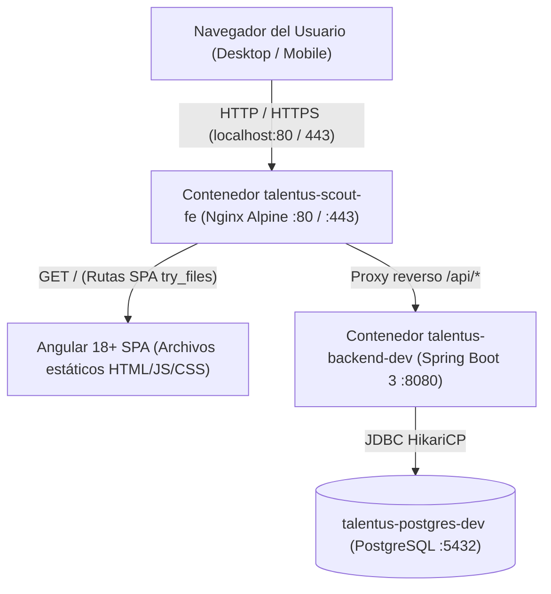

# Plan de Implementación: [TS-06] Inicialización del Frontend Angular (talentus-scout-fe) en Docker Compose con Nginx

**ID Tarea:** TS-06  
**Tarjeta Trello:** [Ver en Trello](https://trello.com/c/KpT4fD4i) (ID: `6abbe1f574830db9b5610610`)  
**Fecha:** 30 de septiembre de 2026  
**Sprint:** Sprint 2 — Frontend Angular en Docker Compose, Bento Grid y Streaming de Video  
**Estado del Plan:** COMPLETADO  
**Agente Planificador:** trello_planner  

---

## 1. Contexto de Negocio y Justificación

* **Problema:** Talentus Scout dispone actualmente del backend Spring Boot 3 y la base de datos PostgreSQL en contenedores Docker, pero carece de una interfaz de usuario web accesible para que los tutores legales, atletas y scouts puedan interactuar con la plataforma desde navegadores de escritorio y dispositivos móviles.
* **Solución:** Inicializar el proyecto Frontend en Angular 18+ (Standalone Components, TypeScript estricto, Angular Signals), empaquetado en un contenedor Docker optimizado con Nginx multi-stage. Nginx actuará como servidor web de producción y reverse proxy local hacia el backend `talentus-scout-be:8080/api/` dentro de la red `talentus-net`, exponiendo la aplicación en los puertos 80 y 443 (SSL).
* **Directiva de Diseño Visual (Obligatoria):** Aplicar estrictamente la skill [fe-desing.md](file:///home/edgar/Talentus%20Scout/fe-desing.md) / [frontend-design](file:///home/edgar/Talentus%20Scout/.agents/skills/frontend-design/SKILL.md), creando una identidad visual única para el fútbol juvenil venezolano (Bento Grid responsivo, paleta atlética de alto contraste, tipografía disciplinada, copywriting humano con verbos activos y cero clichés genéricos de IA).
* **Seguridad y LOPNNA:** Implementar los flujos de autenticación iniciales (Login y Registro de Tutor) con consentimiento explícito del Artículo 65 de la LOPNNA y almacenamiento seguro de token JWT en el cliente.

---

## 2. Alcance Técnico y Arquitectura



### Arquitectura de Carpetas en `talentus-scout-fe/`:
```
talentus-scout-fe/
├── Dockerfile
├── nginx.conf
├── package.json
├── tsconfig.json
├── angular.json
├── src/
│   ├── index.html
│   ├── main.ts
│   ├── styles.css (Tokens de diseño base: paleta, tipografía, variables)
│   └── app/
│       ├── app.routes.ts
│       ├── app.component.ts
│       ├── core/
│       │   ├── auth/
│       │   │   ├── auth.service.ts (Signals: currentUser, token, isAuthenticated)
│       │   │   ├── auth.guard.ts
│       │   │   └── jwt.interceptor.ts
│       │   └── models/
│       │       ├── user.model.ts
│       │       └── auth.model.ts
│       ├── features/
│       │   ├── landing/
│       │   │   └── landing.component.ts (Hero atlético, propuesta de valor, Bento Grid)
│       │   ├── auth/
│       │   │   ├── login/login.component.ts
│       │   │   └── register-tutor/register-tutor.component.ts (Card LOPNNA Art. 65)
│       │   └── dashboard/
│       │       └── tutor-dashboard.component.ts (Resumen del tutor autenticado)
│       └── shared/
│           └── components/
│               └── navbar/navbar.component.ts
```

---

## 3. Tokens de Diseño Visual (Conforme a `frontend-design`)

En apego a [fe-desing.md](file:///home/edgar/Talentus%20Scout/fe-desing.md):

### 3.1. Paleta de Color Intencional (Athletic Scouting Pitch)
* **`--color-bg-base`**: `#0A0F1D` (Slate nocturno deportivo; profundidad sin ser negro absoluto ni gris genérico).
* **`--color-surface`**: `#141D30` (Navy carbón para tarjetas y celdas Bento).
* **`--color-surface-hover`**: `#1A253D` (Micro-interacción de superficie sutil).
* **`--color-border`**: `#22314D` (Borde sutil para estructura informativa nítida).
* **`--color-accent-pitch`**: `#10B981` (Verde esmeralda campo de juego; energía deportiva para acciones clave).
* **`--color-accent-gold`**: `#F59E0B` (Ámbar dorado para insignias de verificación y licencias oficiales).
* **`--color-text-main`**: `#F8FAFC` (Blanco tiza de alta legibilidad, contraste AAA).
* **`--color-text-muted`**: `#94A3B8` (Gris acero para metadatos y etiquetas secundarias).
* **`--color-danger`**: `#EF4444` (Rojo vivo para alertas y errores de formulario).

### 3.2. Prohibición Expresa de Clichés de IA
* **NO** usar fondo crema `#F4F1EA` con acento terracota `#D97757` (firma clásica de IA).
* **NO** usar tarjetas redondeadas idénticas con sombra suave uniforme `rgba(0,0,0,.1)`. Las tarjetas deben usar bordes nítidos (`border: 1px solid var(--color-border)`) con radio moderado (`12px` - `16px`) y jerarquía de tamaño.
* **NO** acentuar una única palabra en negrita o color dentro de los encabezados.
* **NO** usar etiquetas ALL-CAPS arbitrarias ni números secuenciales decorativos (`01 / 02`) si el contenido no es un proceso por etapas real.
* **NO** colocar animaciones `fade-and-slide` indiscriminadas en cada bloque. Movimiento únicamente en respuesta a acciones del usuario.

### 3.3. UX Copywriting
* Verbos en voz activa orientados al usuario: *"Entrar a mi cuenta"*, *"Registrar tutor legal"*, *"Guardar datos"*.
* Card legal LOPNNA con redacción directa y protectora para los padres venezolanos.

---

## 4. Contratos de API Backend Consumidos

| Endpoint | Método | Auth | Request Body | Response Esperado |
| :--- | :---: | :---: | :--- | :--- |
| `/api/v1/auth/login` | `POST` | Público | `LoginRequest` (`email`, `password`) | `AuthResponse` (`token`, `expiresIn`, `userId`, `email`, `fullName`, `role`) |
| `/api/v1/auth/register-tutor` | `POST` | Público | `RegisterTutorRequest` (`fullName`, `email`, `password`, `phoneNumber`, `acceptLopnnaTerms`) | `RegisterTutorResponse` (`userId`, `token`, `role`, `email`, `fullName`) |
| `/api/v1/auth/me` | `GET` | Bearer JWT | Vacío | `UserProfileResponse` (`id`, `email`, `fullName`, `phoneNumber`, `role`, `status`) |

---

## 5. Especificación Frontend (Angular 18+ Standalone)

### 5.1. Manejo de Estado con Angular Signals (`AuthService`)
* `currentUser = signal<User | null>(null)`
* `token = signal<string | null>(localStorage.getItem('talentus_token'))`
* `isAuthenticated = computed(() => !!this.token())`
* Métodos: `login()`, `registerTutor()`, `fetchCurrentUser()`, `logout()`.

### 5.2. Interceptor HTTP (`jwt.interceptor.ts`)
* Inyecta el header `Authorization: Bearer <token>` automáticamente a todas las peticiones dirigidas a `/api/`.
* Si el backend responde `401 Unauthorized`, limpia el token y redirige a `/login`.

### 5.3. Componentes a Implementar
1. **`NavbarComponent`**: Barra de navegación superior con logotipo de Talentus Scout, enlaces públicos y botón de acceso o perfil según estado de autenticación.
2. **`LandingComponent`**: Página de inicio con Hero atlético, propuesta de valor para familias y cazatalentos, y vista previa interactiva Bento.
3. **`LoginComponent`**: Formulario reactivo con validación de email y contraseña, mensajes de error accesibles y enlace al registro.
4. **`RegisterTutorComponent`**: Formulario reactivo con:
   * Nombre completo, correo, contraseña (mínimo 8 caracteres).
   * Teléfono en formato internacional (`+58...`).
   * **Tarjeta interactiva de Protección Legal LOPNNA (Art. 65)** con checkbox obligatorio, enlace al marco legal y advertencia sobre consentimiento informado.
5. **`TutorDashboardComponent`**: Vista protegida para el tutor tras iniciar sesión, mostrando saludo personalizado, tarjeta de bienvenida y accesos rápidos para registrar representados (preparando `TS-05` en frontend).

---

## 6. Especificación de Infraestructura y Docker

### 6.1. Multi-Stage `Dockerfile` (`talentus-scout-fe/Dockerfile`)
* **Stage 1 (Builder):** `node:22-alpine`
  * `WORKDIR /app`
  * `COPY package*.json ./`
  * `RUN npm ci`
  * `COPY . .`
  * `RUN npm run build -- --configuration=production`
* **Stage 2 (Runtime):** `nginx:1.27-alpine`
  * Copiar bundle compilado a `/usr/share/nginx/html`.
  * Copiar configuración personalizada a `/etc/nginx/conf.d/default.conf`.
  * Exponer puertos `80` y `443`.

### 6.2. Configuración de Nginx (`talentus-scout-fe/nginx.conf`)
* Soporte para SPA: `try_files $uri $uri/ /index.html;`.
* Reverse proxy para backend:
  ```nginx
  location /api/ {
      proxy_pass http://talentus-scout-be:8080/api/;
      proxy_http_version 1.1;
      proxy_set_header Upgrade $http_upgrade;
      proxy_set_header Connection 'upgrade';
      proxy_set_header Host $host;
      proxy_cache_bypass $http_upgrade;
      proxy_set_header X-Real-IP $remote_addr;
      proxy_set_header X-Forwarded-For $proxy_add_x_forwarded_for;
      proxy_set_header X-Forwarded-Proto $scheme;
  }
  ```
* Configuración SSL opcional con certificados locales en `/etc/nginx/ssl`.
* Compresión gzip y cabeceras de seguridad (`X-Frame-Options`, `X-Content-Type-Options`, `Referrer-Policy`).

### 6.3. Certificados SSL Locales
* Crear carpeta `nginx/ssl` con script generador de certificado autofirmado para desarrollo local (`scripts/generate_ssl_certs.sh`).

### 6.4. Actualización en `docker-compose.yml`
```yaml
  # 4. FRONTEND ANGULAR + NGINX
  talentus-scout-fe:
    build:
      context: ./talentus-scout-fe
      dockerfile: Dockerfile
    image: talentus-scout-fe:latest
    container_name: talentus-frontend-dev
    ports:
      - "80:80"
      - "443:443"
    depends_on:
      - talentus-scout-be
    volumes:
      - ./nginx/ssl:/etc/nginx/ssl:ro
    networks:
      - talentus-net
```

---

## 7. Checklist de Implementación Paso a Paso (Para `trello_implementer`)

- [x] **Paso 1:** Generar certificados SSL locales para desarrollo en `nginx/ssl/` con script automatizado.
- [x] **Paso 2:** Inicializar el proyecto Angular 18+ en la carpeta `talentus-scout-fe` con Standalone Components y Routing.
- [x] **Paso 3:** Implementar el archivo de estilos globales `src/styles.css` aplicando los tokens de diseño de [fe-desing.md](file:///home/edgar/Talentus%20Scout/fe-desing.md).
- [x] **Paso 4:** Implementar el modelo de datos e interfaces TypeScript (`user.model.ts`, `auth.model.ts`).
- [x] **Paso 5:** Implementar `AuthService`, `AuthGuard` y `JwtInterceptor` con Angular Signals y `HttpClient`.
- [x] **Paso 6:** Construir los componentes visuales: `NavbarComponent`, `LandingComponent`, `LoginComponent`, `RegisterTutorComponent` (con LOPNNA) y `TutorDashboardComponent`.
- [x] **Paso 7:** Configurar `nginx.conf` con enrutamiento SPA y proxy reverso a `talentus-scout-be:8080/api/`.
- [x] **Paso 8:** Crear el `Dockerfile` multi-stage para `talentus-scout-fe` y probar la compilación con `npm run build`.
- [x] **Paso 9:** Integrar el servicio `talentus-scout-fe` en `docker-compose.yml` y validar el levantamiento conjunto (`docker compose up -d --build`).
- [x] **Paso 10:** Probar el flujo completo de Login y Registro de Tutor consumiendo el backend a través de Nginx (`http://localhost` y endpoints `/api/v1/auth/*`).
- [x] **Paso 11:** Actualizar el plan a `[x]`, hacer commit y mover la tarjeta `[TS-06]` a `in testing` en Trello.

---

## 8. Criterios de Aceptación (Definition of Done - DoD)

1. El proyecto Angular 18+ compila limpiamente (`npm run build`) sin errores de TypeScript ni advertencias de linting.
2. El contenedor `talentus-scout-fe` se construye e inicia exitosamente con `docker compose up -d talentus-scout-fe`.
3. `http://localhost` carga la aplicación en el navegador con la identidad visual distintiva de [fe-desing.md](file:///home/edgar/Talentus%20Scout/fe-desing.md) (sin clichés genéricos de IA).
4. El proxy reverso de Nginx redirige correctamente las peticiones `/api/*` a `talentus-scout-be:8080/api/*`.
5. El registro de tutor permite crear un usuario con aceptación obligatoria de LOPNNA Art. 65 y autentica la sesión.
6. El inicio de sesión almacena el token JWT y permite acceder al panel privado del tutor.
7. La tarjeta `[TS-06]` en Trello se traslada a la columna `in testing`.
