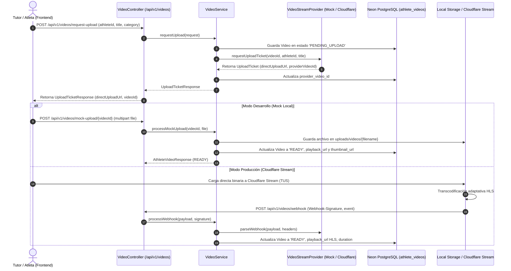

# Plan de Implementación: [TS-07] Pipeline de Video Streaming con Abstracción de Proveedor (Mock Local / Cloudflare)

**ID Tarea:** TS-07  
**Tarjeta Trello:** [Ver en Trello](https://trello.com/c/mT5ZTGxC/44-ts-07-pipeline-de-video-streaming-con-abstracci%C3%B3n-de-proveedor-mock-local-cloudflare) (ID: `6abbe1f6934c2165dfa652fe`)  
**Fecha:** 5 de octubre de 2026  
**Sprint:** Sprint 2 — Multimedia, Perfil Público y Verificación  
**Estado del Plan:** COMPLETADO (LISTO PARA PRUEBAS)  
**Agente Planificador:** trello_planner  
**Agente Implementador:** trello_implementer  

---

## 1. Contexto de Negocio y Justificación

* **Problema:** Los perfiles de atletas requieren videos de alta calidad (jugadas destacadas, goles, habilidades) para captar el interés de scouts y clubes. Sin embargo, procesar y almacenar archivos de video de hasta 500MB directamente en los servidores de backend colapsaría la memoria RAM, el ancho de banda y la capacidad de escalamiento en GCP Cloud Run, además de generar costos prohibitivos durante el desarrollo local si se requiriera una suscripción paga a Cloudflare Stream desde el día 1.
* **Solución:** Implementar un patrón de arquitectura **Direct-to-Cloud** con una capa de abstracción desacoplada (`VideoStreamProvider`):
  1. En **desarrollo local (`mock`)**: El sistema utiliza `MockLocalVideoStreamProvider`, simulando la subida a un endpoint local (`/api/v1/videos/mock-upload/{id}`), guardando el archivo en `uploads/videos/`, sirviéndolo como recurso estático HTTP y transicionando el estado a `READY` sin requerir credenciales externas.
  2. En **producción (`cloudflare`)**: El sistema utiliza `CloudflareStreamProvider`, generando URLs de carga directa (Direct Upload URLs) para que el frontend suba los bytes directamente a la infraestructura perimetral de Cloudflare Stream mediante TUS/HTTP, y recibiendo notificaciones asíncronas vía webhook con validación criptográfica HMAC (`Webhook-Signature`).
* **Reglas de Acceso y Negocio Acordadas:**
  * **Solicitud de subida (`POST /api/v1/videos/request-upload`):** Permitido para roles `TUTOR`, `ATHLETE` y `ADMIN` autenticados con JWT.
  * **Webhook de streaming (`POST /api/v1/videos/webhook`):** Endpoint público (`permitAll`), validado internamente por el proveedor correspondiente.
  * **Subida mock local (`POST /api/v1/videos/mock-upload/{videoId}`):** Endpoint para recibir el archivo binario en entornos de desarrollo y poner el video en estado `READY`.
  * **Consulta de videos (`GET /api/v1/athletes/{athleteId}/videos`):** Endpoint para listar los videos de un atleta y monitorear su estado (`PENDING_UPLOAD`, `PROCESSING`, `READY`, `FAILED`).

---

## 2. Alcance Técnico y Arquitectura



---

## 3. Modelo de Datos y Persistencia

El esquema de base de datos ya fue aprovisionado en la migración canónica `20260929171117_create_initial_schema.sql`:

```sql
-- ENUM de estado de video
CREATE TYPE video_status AS ENUM ('PENDING_UPLOAD', 'PROCESSING', 'READY', 'FAILED');

-- Tabla athlete_videos
CREATE TABLE athlete_videos (
    id UUID PRIMARY KEY DEFAULT uuid_generate_v4(),
    athlete_id UUID NOT NULL REFERENCES athletes(id) ON DELETE CASCADE,
    title VARCHAR(150) NOT NULL,
    category VARCHAR(50) NOT NULL DEFAULT 'HIGHLIGHTS',
    provider_video_id VARCHAR(100) NOT NULL,
    playback_url TEXT,
    thumbnail_url TEXT,
    duration_seconds INT DEFAULT 0,
    status video_status NOT NULL DEFAULT 'PENDING_UPLOAD',
    sort_order INT NOT NULL DEFAULT 1,
    created_at TIMESTAMP WITH TIME ZONE DEFAULT CURRENT_TIMESTAMP
);

CREATE INDEX idx_videos_athlete ON athlete_videos(athlete_id, sort_order);
```

### 3.1. Entidades y Enums Java a Crear

#### Enum: `com.talentus.scout.domain.enums.VideoStatus`
Valores: `PENDING_UPLOAD`, `PROCESSING`, `READY`, `FAILED`.

#### Enum: `com.talentus.scout.domain.enums.VideoCategory`
Valores: `HIGHLIGHTS`, `GOLES`, `ASISTENCIAS`, `DEFENSA`, `PARTIDO_COMPLETO`.

#### Entidad JPA: `com.talentus.scout.domain.entity.AthleteVideo`
* Mapeo contra tabla `athlete_videos`.
* Relación `@ManyToOne(fetch = FetchType.LAZY) @JoinColumn(name = "athlete_id", nullable = false) Athlete athlete`.
* Atributo `status` mapeado como `@Enumerated(EnumType.STRING)` (con converter o cast para PostgreSQL enum).
* Atributo `category` mapeado como `@Enumerated(EnumType.STRING)`.
* Campos: `id`, `title`, `providerVideoId`, `playbackUrl`, `thumbnailUrl`, `durationSeconds`, `sortOrder`, `createdAt`.

#### Repositorio: `com.talentus.scout.repository.AthleteVideoRepository`
* `List<AthleteVideo> findByAthleteIdOrderBySortOrderAscCreatedAtDesc(UUID athleteId);`
* `Optional<AthleteVideo> findByProviderVideoId(String providerVideoId);`
* `long countByAthleteId(UUID athleteId);`

---

## 4. Especificación Backend (Spring Boot 3 / Java 21)

### 4.1. Contrato de Abstracción: `VideoStreamProvider`
Ubicación: `com.talentus.scout.service.video.VideoStreamProvider`

```java
public interface VideoStreamProvider {
    UploadTicket requestUploadTicket(UUID videoId, UUID athleteId, String title);
    VideoDetails parseWebhook(String payload, Map<String, String> headers);
    String getProviderName();
}
```

Modelos de soporte:
* `com.talentus.scout.service.video.model.UploadTicket`:
  * `String directUploadUrl`
  * `String providerVideoId`
  * `long maxSizeBytes`
* `com.talentus.scout.service.video.model.VideoDetails`:
  * `String providerVideoId`
  * `VideoStatus status`
  * `String playbackUrl`
  * `String thumbnailUrl`
  * `Integer durationSeconds`

### 4.2. Implementación Mock Local: `MockLocalVideoStreamProvider`
Ubicación: `com.talentus.scout.service.video.impl.MockLocalVideoStreamProvider`

* Anotación: `@Component` con `@ConditionalOnProperty(name = "talentus.video.provider", havingValue = "mock", matchIfMissing = true)`
* Lógica:
  * Genera `directUploadUrl` apuntando a: `${talentus.video.mock.base-url:http://localhost:8080}/api/v1/videos/mock-upload/` + `videoId`.
  * Genera `providerVideoId = "mock-" + UUID.randomUUID()`.
  * En `parseWebhook`: Parsea un payload JSON simple de prueba para testing sin firma criptográfica obligatoria.

### 4.3. Implementación Cloudflare: `CloudflareStreamProvider`
Ubicación: `com.talentus.scout.service.video.impl.CloudflareStreamProvider`

* Anotación: `@Component` con `@ConditionalOnProperty(name = "talentus.video.provider", havingValue = "cloudflare")`
* Propiedades inyectadas:
  * `talentus.video.cloudflare.account-id`
  * `talentus.video.cloudflare.api-token`
  * `talentus.video.cloudflare.webhook-secret`
* Lógica:
  * Llamada HTTP POST a `https://api.cloudflare.com/client/v4/accounts/{accountId}/stream/direct_upload` usando `RestClient`.
  * Cabeceras: `Authorization: Bearer {apiToken}`, `Content-Type: application/json`.
  * Body: `{"maxDurationSeconds": 600, "meta": {"name": "{title}", "athleteId": "{athleteId}", "videoId": "{videoId}"}}`.
  * Extrae `uploadURL` y `uid` de la respuesta de Cloudflare.
  * En `parseWebhook`: Valida la firma HMAC-SHA256 del header `Webhook-Signature` contra `webhook-secret` y extrae el estado (`ready`, `erroneous`), el HLS playback URL (`https://videodelivery.net/{uid}/manifest/video.m3u8`), y el thumbnail URL (`https://videodelivery.net/{uid}/thumbnails/thumbnail.jpg`).

### 4.4. DTOs (Request / Response)
Ubicación: `com.talentus.scout.web.dto.video`

1. `RequestUploadRequest`:
   * `UUID athleteId` (`@NotNull`)
   * `String title` (`@NotBlank @Size(max = 150)`)
   * `VideoCategory category` (`@NotNull`)
2. `UploadTicketResponse`:
   * `UUID videoId`
   * `String directUploadUrl`
   * `String providerVideoId`
   * `long maxSizeBytes`
3. `AthleteVideoResponse`:
   * `UUID id`
   * `UUID athleteId`
   * `String title`
   * `VideoCategory category`
   * `String providerVideoId`
   * `String playbackUrl`
   * `String thumbnailUrl`
   * `Integer durationSeconds`
   * `VideoStatus status`
   * `Integer sortOrder`
   * `Instant createdAt`
4. `WebhookResponse`:
   * `String status`
   * `String message`

### 4.5. Servicio: `VideoService`
Ubicación: `com.talentus.scout.service.VideoService`

Métodos:
1. `UploadTicketResponse requestUpload(RequestUploadRequest request, User currentUser)`:
   * Valida existencia del atleta.
   * Crea registro `AthleteVideo` con status `PENDING_UPLOAD`.
   * Invoca `videoStreamProvider.requestUploadTicket(...)`.
   * Asigna `providerVideoId` al video y persiste.
   * Retorna `UploadTicketResponse`.
2. `AthleteVideoResponse processMockUpload(UUID videoId, MultipartFile file)`:
   * Valida existencia y estado del video (`PENDING_UPLOAD`).
   * Guarda el archivo en `uploads/videos/{videoId}-{filename}`.
   * Asigna `playbackUrl = "http://localhost:8080/uploads/videos/{filename}"`.
   * Asigna `thumbnailUrl = "http://localhost:8080/uploads/videos/default-thumbnail.jpg"`.
   * Actualiza `status = READY`, `durationSeconds = 60` (simulado).
   * Retorna `AthleteVideoResponse`.
3. `void processWebhook(String payload, Map<String, String> headers)`:
   * Invoca `videoStreamProvider.parseWebhook(payload, headers)`.
   * Busca `AthleteVideo` por `providerVideoId`.
   * Actualiza `status`, `playbackUrl`, `thumbnailUrl`, `durationSeconds`.
4. `List<AthleteVideoResponse> getVideosByAthlete(UUID athleteId)`:
   * Retorna la lista ordenada de videos del atleta.

### 4.6. Controlador REST: `VideoController`
Ubicación: `com.talentus.scout.web.controller.VideoController`
Ruta base: `/api/v1/videos`

Endpoints:
* `POST /api/v1/videos/request-upload`
  * Seguridad: `@PreAuthorize("hasAnyRole('TUTOR', 'ATHLETE', 'ADMIN')")`
  * Status: `201 Created`
  * Retorna: `UploadTicketResponse`
* `POST /api/v1/videos/mock-upload/{videoId}`
  * Consumes: `multipart/form-data`
  * Seguridad: `@PreAuthorize("hasAnyRole('TUTOR', 'ATHLETE', 'ADMIN')")`
  * Status: `200 OK`
  * Retorna: `AthleteVideoResponse`
* `POST /api/v1/videos/webhook`
  * Seguridad: Público (`permitAll()`)
  * Headers: `@RequestHeader Map<String, String> headers`
  * Body: `@RequestBody String payload`
  * Status: `200 OK`
  * Retorna: `WebhookResponse`
* `GET /api/v1/athletes/{athleteId}/videos`
  * Seguridad: Público / autenticado (`permitAll()`)
  * Status: `200 OK`
  * Retorna: `List<AthleteVideoResponse>`

### 4.7. Configuración de Recursos Estáticos y Seguridad
1. **Configuración de Spring MVC (`WebConfig.java`):**
   * Configurar `ResourceHandler` para mapear `/uploads/videos/**` al directorio físico local `file:uploads/videos/`.
2. **Configuración de Seguridad (`SecurityConfig.java`):**
   * Añadir regla `requestMatchers(HttpMethod.POST, "/api/v1/videos/webhook").permitAll()`.
   * Añadir regla `requestMatchers(HttpMethod.GET, "/uploads/**").permitAll()`.
   * Añadir regla `requestMatchers(HttpMethod.GET, "/api/v1/athletes/*/videos").permitAll()`.

---

## 5. Especificación Frontend (Conexión Futura para TS-08 / TS-09)

* **Endpoints a consumir:**
  * Solicitar ticket de subida: `POST /api/v1/videos/request-upload`
  * Cargar archivo binario: URL devuelta en `directUploadUrl` (en local apunta a `/api/v1/videos/mock-upload/{videoId}`, en producción apunta a Cloudflare).
  * Monitorear estado: `GET /api/v1/athletes/{athleteId}/videos`
* **Interfaces TypeScript de referencia (`src/app/core/models/video.model.ts`):**
  ```typescript
  export type VideoStatus = 'PENDING_UPLOAD' | 'PROCESSING' | 'READY' | 'FAILED';
  export type VideoCategory = 'HIGHLIGHTS' | 'GOLES' | 'ASISTENCIAS' | 'DEFENSA' | 'PARTIDO_COMPLETO';

  export interface UploadTicketResponse {
    videoId: string;
    directUploadUrl: string;
    providerVideoId: string;
    maxSizeBytes: number;
  }

  export interface AthleteVideoResponse {
    id: string;
    athleteId: string;
    title: string;
    category: VideoCategory;
    providerVideoId: string;
    playbackUrl: string;
    thumbnailUrl: string;
    durationSeconds: number;
    status: VideoStatus;
    sortOrder: number;
    createdAt: string;
  }
  ```

---

## 6. Plan de Pruebas y Validación

### 6.1. Pruebas Automatizadas (JUnit 5 + MockMvc)
1. **`MockLocalVideoStreamProviderTest`:**
   * Valida generación de ticket de subida con URL local y providerId mock.
   * Valida parseo de webhook simulado.
2. **`CloudflareStreamProviderTest`:**
   * Valida formateo de petición de subida directa a la API de Cloudflare con mock de `RestClient`.
   * Valida verificación de firma HMAC en encabezado `Webhook-Signature`.
3. **`VideoControllerIntegrationTest`:**
   * `POST /api/v1/videos/request-upload`: Con token JWT válido retorna `201 Created` y ticket con status `PENDING_UPLOAD`.
   * `POST /api/v1/videos/mock-upload/{videoId}`: Envía `MockMultipartFile` y retorna `200 OK` con estado `READY` y URLs pobladas.
   * `POST /api/v1/videos/webhook`: Envía payload y retorna `200 OK`.
   * `GET /api/v1/athletes/{athleteId}/videos`: Retorna lista con los videos cargados.

### 6.2. Comandos cURL de Verificación Manual

1. **Solicitar Ticket de Carga:**
   ```bash
   curl -X POST http://localhost:8080/api/v1/videos/request-upload \
     -H "Content-Type: application/json" \
     -H "Authorization: Bearer <JWT_TOKEN>" \
     -d '{
       "athleteId": "<ATHLETE_UUID>",
       "title": "Jugadas Destacadas Torneo Clausura",
       "category": "HIGHLIGHTS"
     }'
   ```

2. **Simular Subida de Archivo en Mock Local:**
   ```bash
   curl -X POST http://localhost:8080/api/v1/videos/mock-upload/<VIDEO_UUID> \
     -H "Authorization: Bearer <JWT_TOKEN>" \
     -F "file=@test_video.mp4"
   ```

3. **Consultar Videos del Atleta:**
   ```bash
   curl -X GET http://localhost:8080/api/v1/athletes/<ATHLETE_UUID>/videos
   ```

4. **Simular Webhook de Proveedor:**
   ```bash
   curl -X POST http://localhost:8080/api/v1/videos/webhook \
     -H "Content-Type: application/json" \
     -H "Webhook-Signature: time=123456,sig1=mock-signature" \
     -d '{
       "uid": "mock-provider-id",
       "status": { "state": "ready" },
       "playback": { "hls": "http://localhost:8080/uploads/videos/sample.m3u8" },
       "thumbnail": "http://localhost:8080/uploads/videos/sample.jpg",
       "duration": 90
     }'
   ```

---

## 7. Checklist de Implementación Paso a Paso (Para trello_implementer)

- [x] **Paso 1: Modelado de Dominio y Repositorio**
  - [x] Crear enum `VideoStatus` (`PENDING_UPLOAD`, `PROCESSING`, `READY`, `FAILED`) en `com.talentus.scout.domain.enums`.
  - [x] Crear enum `VideoCategory` (`HIGHLIGHTS`, `GOLES`, `ASISTENCIAS`, `DEFENSA`, `PARTIDO_COMPLETO`) en `com.talentus.scout.domain.enums`.
  - [x] Crear entidad JPA `AthleteVideo` en `com.talentus.scout.domain.entity` mapeando tabla `athlete_videos`.
  - [x] Crear repositorio `AthleteVideoRepository` en `com.talentus.scout.repository`.

- [x] **Paso 2: Capa de Abstracción de Streaming (Provider SPI)**
  - [x] Crear interfaz `VideoStreamProvider` en `com.talentus.scout.service.video`.
  - [x] Crear DTOs de transporte `UploadTicket` y `VideoDetails` en `com.talentus.scout.service.video.model`.
  - [x] Implementar `MockLocalVideoStreamProvider` con `@ConditionalOnProperty(name = "talentus.video.provider", havingValue = "mock", matchIfMissing = true)`.
  - [x] Implementar `CloudflareStreamProvider` con `@ConditionalOnProperty(name = "talentus.video.provider", havingValue = "cloudflare")`.

- [x] **Paso 3: DTOs y Lógica de Negocio**
  - [x] Crear DTOs: `RequestUploadRequest`, `UploadTicketResponse`, `AthleteVideoResponse`, `WebhookResponse` en `com.talentus.scout.web.dto.video`.
  - [x] Implementar `VideoService` en `com.talentus.scout.service`.
  - [x] Asegurar creación del directorio `uploads/videos/` si no existe al arrancar o al procesar la subida local.

- [x] **Paso 4: Endpoints REST y Seguridad**
  - [x] Implementar `VideoController` con endpoints `/api/v1/videos/request-upload`, `/api/v1/videos/mock-upload/{videoId}`, `/api/v1/videos/webhook` y `GET /api/v1/athletes/{athleteId}/videos`.
  - [x] Configurar `ResourceHandler` en `WebConfig` para exponer `/uploads/videos/**`.
  - [x] Actualizar `SecurityConfig` autorizando webhook y recursos estáticos sin token, y restringiendo `request-upload` y `mock-upload` a roles autenticados (`TUTOR`, `ATHLETE`, `ADMIN`).

- [x] **Paso 5: Configuración de Entorno**
  - [x] Actualizar `application.yml` en `talentus-scout-be` con propiedades por defecto para `talentus.video.provider=mock`, ruta de almacenamiento local y placeholders de Cloudflare.

- [x] **Paso 6: Pruebas y Validación**
  - [x] Escribir pruebas unitarias para `MockLocalVideoStreamProvider` y `CloudflareStreamProvider`.
  - [x] Escribir pruebas de integración con `MockMvc` para `VideoController`.
  - [x] Validar compilación completa del backend con `./mvnw clean test-compile` o `./mvnw test`.

---

## 8. Criterios de Aceptación (Definition of Done - DoD)

- [x] La compilación del backend pasa sin errores (`./mvnw clean compile`).
- [x] En entorno local, la configuración por defecto usa `mock`, permitiendo solicitar un ticket de subida y realizar la carga mediante `mock-upload` sin requerir credenciales de Cloudflare.
- [x] El video transiciona a estado `READY` y genera URLs funcionales para visualización estática en local.
- [x] El cliente `CloudflareStreamProvider` queda listo para activarse mediante configuración (`talentus.video.provider=cloudflare`) con validación de webhook HMAC.
- [x] Las pruebas automatizadas unitarias y de integración pasan exitosamente.
