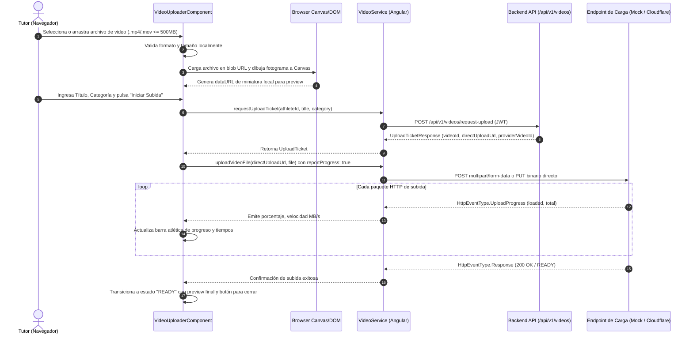

# Plan de Implementación: [TS-08] Componente Frontend de Subida de Video con Barra de Progreso y Miniatura

**ID Tarea:** TS-08  
**Tarjeta Trello:** [Ver en Trello](https://trello.com/c/Nhps4oJk/45-ts-08-componente-frontend-de-subida-de-video-con-barra-de-progreso-y-miniatura) (ID: `6abbe1f7dadbc41e88613440`)  
**Fecha:** 5 de octubre de 2026  
**Sprint:** Sprint 2 — Multimedia, Perfil Público y Verificación  
**Estado del Plan:** LISTO PARA IMPLEMENTACIÓN  
**Agente Planificador:** trello_planner  
**Agente Implementador:** trello_implementer  

---

## 1. Contexto de Negocio y Justificación

* **Problema:** En el fútbol formativo venezolano, los padres y tutores capturan jugadas, goles y destrezas con teléfonos celulares de diversas gamas y conexiones móviles variables (4G/LTE intermitente, WiFi doméstico). Si una interfaz de subida es opaca, no indica el avance porcentual o falla sin informar la causa (archivo superior a 500MB, formato incompatible o caída de conexión), el tutor abandona el proceso, impidiendo que el atleta exhiba su talento a scouts y clubes.
* **Solución:** Diseñar e implementar un componente de carga de video de alta resiliencia en Angular 18+ (`VideoUploaderComponent`) que proporcione:
  1. **Generación Instantánea de Miniatura (Client-Side Thumbnail):** Extracción del primer cuadro mediante HTML5 `<video>` y `<canvas>` en el navegador antes de iniciar la transmisión de bytes, dando certeza inmediata al tutor del contenido seleccionado.
  2. **Monitoreo de Carga en Tiempo Real:** Barra de progreso fluida basada en eventos HTTP (`HttpEventType.UploadProgress`), con visualización de porcentaje exacto, volumen transferido (MB / Total MB) y velocidad estimada.
  3. **Validación Estricta Preventiva:** Rechazo local inmediato de archivos mayores a 500MB o extensiones no admitidas (únicamente MP4 y MOV), ahorrando ancho de banda.
  4. **Feedback de Transcodificación Asíncrona:** Transición de estados visuales claros (*Selección -> Listo para Subir -> Transfiriendo -> Procesando en Servidor -> Listo*).
  5. **Diseño Visual Atlético y Propio:** Adherencia estricta a [fe-desing.md](file:///home/edgar/Talentus%20Scout/fe-desing.md) (cero clichés SaaS o kits genéricos de IA, contrastes deportivos con jerarquía y accesibilidad).

---

## 2. Alcance Técnico y Arquitectura



---

## 3. Modelo de Datos y Contratos Backend (Integración con TS-07)

El componente frontend consumirá los endpoints y modelos ya implementados y validados en el backend:

### 3.1. Solicitud de Ticket (`POST /api/v1/videos/request-upload`)
* **Headers:** `Authorization: Bearer <JWT_TOKEN>`, `Content-Type: application/json`
* **Request Payload (`RequestUploadRequest`):**
  ```json
  {
    "athleteId": "3fa85f64-5717-4562-b3fc-2c963f66afa6",
    "title": "Goles y Regates Torneo Apertura 2026",
    "category": "HIGHLIGHTS"
  }
  ```
* **Response Payload (`UploadTicketResponse`):**
  ```json
  {
    "videoId": "8b7c3d2e-1111-2222-3333-444455556666",
    "directUploadUrl": "http://localhost:8080/api/v1/videos/mock-upload/8b7c3d2e-1111-2222-3333-444455556666",
    "providerVideoId": "mock-8b7c3d2e-1111-2222-3333-444455556666",
    "maxSizeBytes": 524288000
  }
  ```

### 3.2. Subida Directa de Archivo (`POST <directUploadUrl>`)
* **Headers:** `Authorization: Bearer <JWT_TOKEN>` (para mock local)
* **Body:** `FormData` con campo `file` conteniendo el archivo binario.
* **Response Payload (`AthleteVideoResponse`):**
  ```json
  {
    "id": "8b7c3d2e-1111-2222-3333-444455556666",
    "athleteId": "3fa85f64-5717-4562-b3fc-2c963f66afa6",
    "title": "Goles y Regates Torneo Apertura 2026",
    "category": "HIGHLIGHTS",
    "providerVideoId": "mock-...",
    "playbackUrl": "http://localhost:8080/uploads/videos/...",
    "thumbnailUrl": "http://localhost:8080/uploads/videos/...",
    "durationSeconds": 90,
    "status": "READY",
    "sortOrder": 1,
    "createdAt": "2026-10-05T10:00:00Z"
  }
  ```

---

## 4. Especificación Frontend (Angular 18+ Standalone & Directiva de Diseño)

### 4.1. Sistema de Tokens Visuales y Dirección de Arte ([fe-desing.md](file:///home/edgar/Talentus%20Scout/fe-desing.md))

Para huir de kits genéricos de IA (fondos terracota o tarjetas monocromáticas idénticas), el cargador de video adopta una atmósfera de **estudio táctico deportivo**:
* **Paleta de Colores Intencional:**
  * Fondo de Zona de Arrastre: `#0F172A` (Azul Noche Táctico) con borde punteado activo `#059669` (Verde Campo/Éxito) al arrastrar.
  * Superficie del Componente: `#1E293B` (Grafito Deportivo) con borde sutil `#334155`.
  * Acento de Progreso y Acción: `#10B981` (Esmeralda Atlético) en degradé hacia `#065F46`.
  * Texto Primario: `#F8FAFC` (Blanco Óptico).
  * Texto Secundario/Meta: `#94A3B8` (Gris Pizarra).
  * Alerta/Error: `#EF4444` (Rojo Carmesí).
* **Tipografía:**
  * Títulos: Semibold con peso atlético, sin mayúsculas sostenidas artificiales.
  * Datos de velocidad y peso: Numéricos claros con tracking balanceado.
* **Layout:**
  * Área de arrastre con drop-zone intuitiva e ícono distintivo de cámara/video.
  * Preview con relación de aspecto 16:9 con badge de miniatura generada en local.
  * Barra de progreso con microanimación de brillo que avanza suavemente.

### 4.2. Modelos TypeScript a Crear

#### Archivo: `src/app/core/models/video.model.ts`
```typescript
export type VideoCategory = 'HIGHLIGHTS' | 'GOLES' | 'ASISTENCIAS' | 'DEFENSA' | 'PARTIDO_COMPLETO';
export type VideoStatus = 'PENDING_UPLOAD' | 'PROCESSING' | 'READY' | 'FAILED';

export interface RequestUploadRequest {
  athleteId: string;
  title: string;
  category: VideoCategory;
}

export interface UploadTicketResponse {
  videoId: string;
  directUploadUrl: string;
  providerVideoId: string;
  maxSizeBytes: number;
}

export interface AthleteVideoResponse {
  id: string;
  athleteId: string;
  title: string;
  category: VideoCategory;
  providerVideoId: string;
  playbackUrl?: string;
  thumbnailUrl?: string;
  durationSeconds?: number;
  status: VideoStatus;
  sortOrder: number;
  createdAt: string;
}

export interface UploadProgressState {
  status: 'idle' | 'selected' | 'requesting_ticket' | 'uploading' | 'processing' | 'ready' | 'error';
  percentage: number;
  loadedBytes: number;
  totalBytes: number;
  speedMbps: number;
  errorMessage?: string;
}
```

### 4.3. Servicio Angular: `VideoUploadService`

#### Archivo: `src/app/core/services/video-upload.service.ts`
* **Inyección:** `providedIn: 'root'`.
* **Métodos Clave:**
  1. `requestUploadTicket(request: RequestUploadRequest): Observable<UploadTicketResponse>`:
     * Llama a `POST /api/v1/videos/request-upload`.
  2. `uploadFileWithProgress(uploadUrl: string, file: File): Observable<HttpEvent<any>>`:
     * Usa `HttpRequest` con `reportProgress: true` y `observe: 'events'` sobre `uploadUrl`.
     * Maneja el payload como `FormData` con clave `file`.
  3. `getVideosByAthlete(athleteId: string): Observable<AthleteVideoResponse[]>`:
     * Llama a `GET /api/v1/athletes/${athleteId}/videos`.
  4. `generateLocalThumbnail(file: File, timeInSeconds = 1): Promise<string>`:
     * Utiliza un elemento `<video>` en memoria con `URL.createObjectURL(file)`.
     * Captura el frame en un `<canvas>` y retorna una cadena base64 `data:image/jpeg;base64,...`.

### 4.4. Componente Standalone: `VideoUploaderComponent`

#### Archivo: `src/app/features/videos/video-uploader.component.ts` (con `.html` y `.css` o inline templated)
* **Entradas (`@Input`):**
  * `athleteId: string` (obligatorio para vincular el video).
  * `athleteName?: string` (para feedback visual personalizado).
* **Salidas (`@Output`):**
  * `videoUploaded = new EventEmitter<AthleteVideoResponse>()` (notifica al componente padre cuando el video está listo).
  * `cancelled = new EventEmitter<void>()`.
* **Estados Visuales del Componente:**
  1. **Estado `IDLE` (Drop-zone):**
     * Zona con soporte para Drag & Drop y selector manual (`<input type="file" accept="video/mp4,video/quicktime">`).
     * Mensaje de límite: "Formatos admitidos: MP4, MOV · Peso máximo: 500 MB".
  2. **Estado `SELECTED` (Configuración y Preview):**
     * Miniatura generada localmente en canvas mostrada en 16:9.
     * Nombre original del archivo y tamaño formateado (ej. `34.8 MB`).
     * Formulario reactivo/ngModel para:
       * Título del video (ej. "Jugadas vs Caracas FC").
       * Categoría (selector visual: *Highlights*, *Goles*, *Asistencias*, *Defensa*, *Partido Completo*).
     * Botones: "Iniciar Subida" y "Cambiar archivo".
  3. **Estado `UPLOADING` (Transferencia activa):**
     * Barra de progreso atlética animada con porcentaje (`0%` a `100%`).
     * Datos métricos dinámicos: "Subidos 24.5 MB de 50.0 MB (4.2 MB/s)".
     * Botón de cancelar transmisión (`subscription.unsubscribe()`).
  4. **Estado `PROCESSING` (Transcodificación):**
     * Spinner pulsante: "Procesando y optimizando streaming...".
  5. **Estado `READY` (Éxito comprobado):**
     * Tarjeta de video con insignia verde "LISTO PARA REPRODUCIR".
     * Preview con thumbnail y título confirmado.
     * Botón "Cargar otro video" y botón "Finalizar".
  6. **Estado `ERROR` (Manejo resiliente):**
     * Mensaje explícito del error (ej. "El archivo excede el tamaño máximo permitido de 500 MB").
     * Botón "Reintentar subida".

### 4.5. Integración en el Dashboard del Tutor (`TutorDashboardComponent`)

* **Ubicación:** `src/app/features/dashboard/tutor-dashboard.component.ts`.
* **Experiencia de Usuario:**
  * En la tarjeta del atleta o mediante un botón de acción rápida *"Subir Video de Jugadas"*, se abre el modal/sección de `VideoUploaderComponent`.
  * Al completar la subida, se actualiza automáticamente el contador de videos y el estado de la ficha del atleta.

---

## 5. Plan de Pruebas y Validación (DoD)

### 5.1. Pruebas Automatizadas Frontend (Angular / Jasmine / Karma)
* **Archivo de Pruebas:** `src/app/features/videos/video-uploader.component.spec.ts`.
* **Escenarios a Validar:**
  1. *should reject file larger than 500MB:* Valida que un archivo simulado de 501MB active el mensaje de error y no llame al servicio.
  2. *should reject non-video file formats:* Valida que un archivo `.pdf` o `.txt` sea rechazado con mensaje descriptivo.
  3. *should request upload ticket and track progress:* Simula eventos `HttpEventType.UploadProgress` y verifica que el porcentaje se actualice de 0% a 100%.
  4. *should emit videoUploaded event upon success:* Comprueba que el `@Output` emita el `AthleteVideoResponse` retornado por el backend.

### 5.2. Guía de Pruebas Manuales
1. Iniciar sesión como tutor legal en el frontend (`http://localhost:4200/login`).
2. Navegar al dashboard (`/dashboard`) y pulsar "Subir Video de Jugadas".
3. Arrastrar un archivo MP4 real de prueba (< 500MB):
   * Verificar que la miniatura se dibuje en pantalla en menos de 1 segundo.
4. Ingresar título "Gol de media cancha", seleccionar categoría "GOLES" y pulsar "Iniciar Subida":
   * Verificar que la barra avance fluidamente mostrando porcentaje y MB.
   * Verificar que al llegar al 100% transicione a estado de confirmación.
5. Probar caso borde: intentar seleccionar un archivo que no sea video o que supere 500MB y comprobar el mensaje de validación inmediato.

---

## 6. Documentación Obligatoria de Pruebas (`test/`)

Antes de mover la tarjeta a `in testing`, el implementador debe generar:
* **Archivo:** `test/TS-08-test-plan-componente-subida-video.md`
* **Contenido:** Evidencia de tests automatizados (`npm test`), verificación manual de estados visuales, capturas o reporte de eventos de subida, y matriz DoD verificada.

---

## 7. Checklist Paso a Paso (Para trello_implementer)

- [x] **Paso 1: Modelos e Interfaces TypeScript**
  - [x] Crear archivo `src/app/core/models/video.model.ts` con `VideoCategory`, `VideoStatus`, DTOs de petición y respuesta, y estado `UploadProgressState`.

- [x] **Paso 2: Servicio Angular de Subida de Video**
  - [x] Crear `src/app/core/services/video-upload.service.ts`.
  - [x] Implementar `requestUploadTicket(athleteId, title, category)`.
  - [x] Implementar `uploadFileWithProgress(directUploadUrl, file)` con `reportProgress: true`.
  - [x] Implementar `generateLocalThumbnail(file)` con Canvas API.
  - [x] Implementar `getVideosByAthlete(athleteId)`.

- [x] **Paso 3: Componente Standalone `VideoUploaderComponent`**
  - [x] Crear `src/app/features/videos/video-uploader.component.ts` (con estilos y template integrados o modulares).
  - [x] Implementar área de Drag & Drop con eventos `dragover`, `dragleave`, `drop`.
  - [x] Implementar validaciones de formato (`video/mp4`, `video/quicktime`) y peso máximo (500MB).
  - [x] Implementar barra de progreso atlética con cálculo de velocidad y porcentaje.
  - [x] Implementar feedback de estados: *Idle*, *Selected/Preview*, *Uploading*, *Processing*, *Ready*, *Error*.
  - [x] Aplicar directrices estéticas de `fe-desing.md` (paleta grafito/esmeralda, copywriting humano, microinteracciones).

- [x] **Paso 4: Integración en el Panel del Tutor (`TutorDashboardComponent`)**
  - [x] Importar `VideoUploaderComponent` en `src/app/features/dashboard/tutor-dashboard.component.ts`.
  - [x] Agregar disparador visual (botón o modal) para cargar videos de un atleta registrado.
  - [x] Conectar evento `@Output videoUploaded` para refrescar la lista de videos del atleta.

- [x] **Paso 5: Pruebas Automatizadas y Compilación**
  - [x] Crear y ejecutar pruebas unitarias en `src/app/features/videos/video-uploader.component.spec.ts`.
  - [x] Ejecutar `npm run build` en `talentus-scout-fe` para validar que no haya errores de tipado o compilación.

- [x] **Paso 6: Documentación del Plan de Pruebas**
  - [x] Redactar y guardar `test/TS-08-test-plan-componente-subida-video.md` con alcance, tests ejecutados y guía cURL / UI.

- [x] **Paso 7: Transición en Trello**
  - [x] Ejecutar script para mover la tarjeta `6abbe1f7dadbc41e88613440` a `in testing` con comentario explicativo.

---

## 8. Criterios de Aceptación (Definition of Done - DoD)

1. [x] **Validación local instantánea:** Archivos no admitidos o que superen 500MB son rechazados en el cliente sin consumir red.
2. [x] **Miniatura generada en cliente:** El usuario visualiza un fotograma de su video antes de enviarlo al servidor.
3. [x] **Barra de progreso reactiva:** Monitoreo en tiempo real del progreso de subida (`UploadProgress`) con porcentaje y MB transferidos.
4. [x] **Integración completa con backend TS-07:** Flujo completo validado contra el endpoint `/api/v1/videos/request-upload` y subida directa.
5. [x] **Diseño intencional y profesional:** Cumplimiento de `fe-desing.md`, sin estilos genéricos ni plantillas prefabricadas.
6. [x] **Compilación limpia:** `npm run build` pasa con cero errores.
7. [x] **Plan de pruebas en `test/`:** Documento `test/TS-08-test-plan-componente-subida-video.md` debidamente generado y enlazado.
