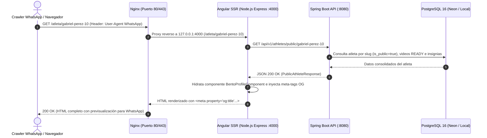

# Plan de Implementación: [TS-09] Perfil Público del Atleta en Angular con SSR y Open Graph Dinámico

**ID Tarea:** TS-09  
**Tarjeta Trello:** [Ver en Trello](https://trello.com/c/2J1D83FU/46-ts-09-perfil-p%C3%BAblico-del-atleta-en-angular-con-ssr-y-open-graph-din%C3%A1mico) (ID: `6abbe1f7742bfe58a08fc79a`)  
**Fecha:** 6 de octubre de 2026  
**Sprint:** Sprint 2 — Multimedia, Perfil Público y Verificación  
**Estado del Plan:** LISTO PARA IMPLEMENTACIÓN  
**Agente Planificador:** trello_planner  
**Agente Implementador:** trello_implementer  

---

## 1. Contexto de Negocio y Justificación

* **Problema:** En el fútbol formativo juvenil venezolano, el canal principal de difusión y viralización es WhatsApp, Instagram y Telegram. Cuando un padre, representante o scout comparte el enlace del perfil de un atleta menor de edad (`https://talentus.app/atleta/gabriel-perez-10`), las plataformas de mensajería analizan el HTML mediante rastreadores automáticos (*crawlers*) como `WhatsApp/2.0` o `facebookexternalhit/1.1`. Si la aplicación es una SPA tradicional del lado del cliente, estos rastreadores solo reciben un `index.html` genérico sin contenido del atleta ni imagen de vista previa, lo que destruye el interés del scout o reclutador.
* **Solución:** Implementar la vitrina pública deportiva del atleta en Angular 18+ con Server-Side Rendering (`@angular/ssr`) y orquestación con Nginx en Docker:
  1. **Server-Side Rendering (SSR):** El servidor ejecuta el renderizado en tiempo real de la ruta `/atleta/:slug`, devolviendo el HTML completo con los datos hidratados antes de enviar la respuesta al navegador o rastreador.
  2. **Inyección Dinámica de Open Graph:** Inyección de meta-tags enriquecidos (`og:title`, `og:description`, `og:image`, `og:url`, `twitter:card`) en el servidor para generar tarjetas de previsualización automáticas y atractivas en WhatsApp e Instagram.
  3. **Maquetado Bento Grid Deportivo Atlético:** Diseño visual de alta identidad conforme a [fe-desing.md](file:///home/edgar/Talentus%20Scout/fe-desing.md), compuesto por:
     * **Tarjeta 1 (Identidad y Ficha Central):** Foto deportiva, nombre, categoría/año de nacimiento, edad cronológica, pierna hábil, posición principal y secundaria, club actual con escudo.
     * **Tarjeta 2 (Biotipo & Antropometría):** Altura (cm), peso (kg), pasaportes secundarios (ej. Comunitario UE) y nacionalidad.
     * **Tarjeta 3 (Reproductor de Video HLS Bento):** Streaming de jugadas destacadas con `hls.js`, bitrate adaptativo y selector de jugadas.
     * **Tarjeta 4 (Insignias de Confianza & Verificación):** Ficha federada oficial, afiliación validada de club y sellos de confianza.
     * **Acción Flotante:** Botón interactivo "Compartir por WhatsApp" con mensaje directo preformateado.
* **Privacidad y LOPNNA (Art. 65):**
  * La vista pública **NUNCA** divulga el número de cédula de identidad del menor, dirección física, número de teléfono del atleta ni correo electrónico de su tutor legal.
  * Solo se expone información atlética y deportiva formativa. Si el tutor marca al atleta como privado (`isPublic = false`), el endpoint público y la ruta responden con `404 Not Found`.

---

## 2. Alcance Técnico y Arquitectura



### Componentes Involucrados:
1. **Backend (`talentus-scout-be`):**
   * Creación de la entidad JPA `AthleteBadge` y enums correspondientes (`BadgeType`, `BadgeStatus`).
   * Creación del repositorio `AthleteBadgeRepository`.
   * Creación de DTOs de respuesta pública: `PublicAthleteResponse`, `PublicClubDto`, `AthleteMetricsDto`, `PublicBadgeDto`, `PublicVideoDto`.
   * Expansión de `AthleteService` con método público `getPublicAthleteBySlug(String slug)`.
   * Exposición del endpoint `GET /api/v1/athletes/public/{slug}` en `AthleteController`.
2. **Frontend (`talentus-scout-fe`):**
   * Integración de `@angular/ssr` y configuración de servidor Express (`server.ts`).
   * Instalación y configuración de biblioteca `hls.js` para streaming HLS de video.
   * Servicio `SeoService` para inyección SSR de Open Graph y Twitter Cards.
   * Componente Standalone `BentoProfileComponent` en `src/app/features/public-profile/`.
   * Componente Standalone `VideoPlayerComponent` en `src/app/shared/components/video-player/`.
   * Registro de la ruta `/atleta/:slug` en `app.routes.ts`.
3. **Contenedorización & Servidor Web:**
   * Actualización del `Dockerfile` de `talentus-scout-fe` a una imagen multi-proceso (Node.js 22 + Nginx Alpine) que arranca el servidor Express de Angular SSR en `127.0.0.1:4000` y expone Nginx en `80` y `443`.
   * Actualización de `nginx.conf` para servir estáticos directamente con caché y delegar `/atleta/` y rutas SPA dinámicas a Node.js SSR.

---

## 3. Modelo de Datos y Migraciones (PostgreSQL / Neon)

La tabla canónica `athlete_badges` ya existe en el esquema de base de datos de migraciones iniciales (`talentus-scout-migrations/migrations/20260929171117_create_initial_schema.sql`):

```sql
-- Estructura de tabla existente en schema:
CREATE TABLE athlete_badges (
    id UUID PRIMARY KEY DEFAULT uuid_generate_v4(),
    athlete_id UUID NOT NULL REFERENCES athletes(id) ON DELETE CASCADE,
    badge_type badge_type NOT NULL,
    organization_id UUID REFERENCES clubs_organizations(id) ON DELETE SET NULL,
    verified_by_user_id UUID REFERENCES users(id) ON DELETE SET NULL,
    status badge_status NOT NULL DEFAULT 'PENDING',
    evidence_document_url TEXT,
    verification_notes TEXT,
    verified_at TIMESTAMP WITH TIME ZONE,
    created_at TIMESTAMP WITH TIME ZONE DEFAULT CURRENT_TIMESTAMP
);

CREATE INDEX idx_badges_athlete ON athlete_badges(athlete_id, status);
```

> [!NOTE]
> No se requieren migraciones DDL adicionales ya que la tabla y los tipos enumerados `badge_type` y `badge_status` se encuentran creados en PostgreSQL.

---

## 4. Backend: Spring Boot 3 (Java 21)

### 4.1. Nuevos Enums en `domain.enums`
* **`com.talentus.scout.domain.enums.BadgeType`**:
  Valores: `FEDERATION_LICENSE`, `CLUB_AFFILIATION`, `MEDICAL_ANTHRO`, `SCOUT_ENDORSEMENT`.
* **`com.talentus.scout.domain.enums.BadgeStatus`**:
  Valores: `PENDING`, `APPROVED`, `REJECTED`.

### 4.2. Entidad JPA `AthleteBadge`
* **Archivo:** `talentus-scout-be/src/main/java/com/talentus/scout/domain/entity/AthleteBadge.java`
* **Anotaciones Lombok:** `@Getter`, `@Setter`, `@NoArgsConstructor`, `@AllArgsConstructor`, `@Builder`, `@Builder.Default`
* **Campos:**
  * `UUID id` (`@Id`, `@GeneratedValue(strategy = GenerationType.UUID)`)
  * `Athlete athlete` (`@ManyToOne(fetch = FetchType.LAZY, optional = false)`, `@JoinColumn(name = "athlete_id")`)
  * `BadgeType badgeType` (`@Enumerated(EnumType.STRING)`, `@JdbcTypeCode(SqlTypes.NAMED_ENUM)`)
  * `ClubOrganization organization` (`@ManyToOne(fetch = FetchType.LAZY)`, `@JoinColumn(name = "organization_id")`)
  * `User verifiedByUser` (`@ManyToOne(fetch = FetchType.LAZY)`, `@JoinColumn(name = "verified_by_user_id")`)
  * `BadgeStatus status` (`@Enumerated(EnumType.STRING)`, `@JdbcTypeCode(SqlTypes.NAMED_ENUM)`, default `PENDING`)
  * `String evidenceDocumentUrl`
  * `String verificationNotes`
  * `Instant verifiedAt`
  * `Instant createdAt`

### 4.3. Repositorio `AthleteBadgeRepository`
* **Archivo:** `talentus-scout-be/src/main/java/com/talentus/scout/repository/AthleteBadgeRepository.java`
* **Métodos:**
  * `List<AthleteBadge> findByAthleteIdAndStatus(UUID athleteId, BadgeStatus status);`

### 4.4. DTOs de Respuesta Pública (`com.talentus.scout.web.dto.publicprofile.*`)
* **`PublicAthleteResponse`:**
  ```java
  @Getter @Setter @NoArgsConstructor @AllArgsConstructor @Builder
  public class PublicAthleteResponse {
      private UUID id;
      private String slug;
      private String fullName;
      private int age;
      private LocalDate birthDate;
      private String gender;
      private String primaryPosition;
      private String secondaryPosition;
      private String preferredFoot;
      private String nationality;
      private String secondaryPassports;
      private String profilePhotoUrl;
      private String bio;
      private PublicClubDto club;
      private AthleteMetricsDto metrics;
      private List<PublicBadgeDto> badges;
      private List<PublicVideoDto> videos;
  }
  ```
* **`PublicClubDto`:** `String name`, `String logoUrl`, `String city`, `String state`.
* **`AthleteMetricsDto`:** `BigDecimal heightCm`, `BigDecimal weightKg`.
* **`PublicBadgeDto`:** `BadgeType type`, `String title`, `boolean verified`, `String organizationName`, `Instant verifiedAt`.
* **`PublicVideoDto`:** `UUID id`, `String title`, `VideoCategory category`, `String playbackUrl`, `String thumbnailUrl`, `Integer durationSeconds`.

### 4.5. Lógica de Servicio en `AthleteService`
* **Método:** `@Transactional(readOnly = true) public PublicAthleteResponse getPublicAthleteBySlug(String slug)`
* **Reglas:**
  1. Buscar atleta por `slug`: `athleteRepository.findBySlug(slug)`. Si no existe o `!athlete.isPublic()`, lanzar `ResourceNotFoundException("Perfil público de atleta no encontrado o inactivo")`.
  2. Obtener videos listos (`VideoStatus.READY`) asociados al atleta ordenados por `sortOrder` y fecha de creación.
  3. Obtener insignias aprobadas (`BadgeStatus.APPROVED`) de la tabla `athlete_badges`. Si el atleta no tiene registros explícitos en `athlete_badges`, construir insignias de confianza dinámicas si posee `federationLicenseNumber` o `currentClub`.
  4. Mapear al DTO `PublicAthleteResponse` mediante `.builder()`.

### 4.6. Controlador REST en `AthleteController`
* **Endpoint:** `GET /api/v1/athletes/public/{slug}`
* **Seguridad:** Público (sin autenticación requerida, ya habilitado en `SecurityConfig`).
* **Respuesta:** `200 OK` con `PublicAthleteResponse`, o `404 Not Found`.

---

## 5. Frontend: Angular 18+ (Standalone, SSR y Open Graph)

### 5.1. Activación de `@angular/ssr` y Dependencias
1. Agregar dependencias en `talentus-scout-fe/package.json`:
   * `@angular/ssr`: `^18.2.0`
   * `express`: `^4.19.2`
   * `@types/express`: `^4.17.21`
   * `hls.js`: `^1.5.15`
   * `@types/hls.js`: `^1.0.0`
2. Generar/configurar `server.ts` con Express para SSR en Angular 18.
3. Configurar `app.config.server.ts` y exportar `provideServerRendering()`.
4. Actualizar `angular.json` para definir la salida del build con soporte `server` y `ssr`.

### 5.2. Tokens de Diseño Visual (En apego estricto a `fe-desing.md`)
* **Atmósfera deportiva:**
  * Fondo: `--color-bg-base: #0A0F1D` (Slate nocturno atlético).
  * Tarjetas Bento: `--color-surface: #141D30` con bordes nítidos `--color-border: #22314D` y radio controlado (`16px`).
  * Acento Campo: `--color-accent-pitch: #10B981` (Verde esmeralda para llamados a la acción y jugadas).
  * Acento Oficial: `--color-accent-gold: #F59E0B` (Ámbar dorado para licencias federativas e insignias verificadas).
  * Tipografía: `Inter, system-ui, sans-serif` con pesos contrastantes para números y estadísticas.
* **Prohibición de clichés:** Cero fondos crema, cero sombras borrosas uniformes, cero badges de texto todo mayúsculas sin función, cero animaciones no gatilladas por el usuario.

### 5.3. Servicio de SEO y Open Graph (`SeoService`)
* **Archivo:** `talentus-scout-fe/src/app/core/services/seo.service.ts`
* Inyección de `Title` y `Meta` de `@angular/platform-browser`.
* Método `setAthleteProfileMeta(athlete: PublicAthleteResponse, currentUrl: string)`:
  * Inyecta:
    * `title`: `${athlete.fullName} (${birthYear}) — ${athlete.primaryPosition} | Talentus Scout`
    * `og:title`: `${athlete.fullName} — ${athlete.primaryPosition} | Talentus Scout`
    * `og:description`: `Ficha deportiva y jugadas destacadas de ${athlete.fullName} (${athlete.age} años). Club: ${clubName}.`
    * `og:image`: URL de foto del atleta o banner deportivo oficial de Talentus Scout.
    * `og:url`: `${currentUrl}`
    * `og:type`: `profile`
    * `twitter:card`: `summary_large_image`

### 5.4. Componente Bento: `BentoProfileComponent`
* **Ubicación:** `talentus-scout-fe/src/app/features/public-profile/`
* **Estructura del Bento Grid:**
  * **Tarjeta 1 — Hero Deportivo:**
    * Avatar o fotografía oficial del jugador con marco atlético.
    * Nombre prominente y dorsal/año de nacimiento.
    * Fila de datos rápidos: Edad cronológica, Pierna Hábil (`Derecho` / `Izquierdo` / `Ambidiestro`), Posición Principal y Posición Secundaria.
    * Escudo y nombre del Club actual (`ClubResponse`).
  * **Tarjeta 2 — Biotipo & Antropometría:**
    * Grilla biométrica con Altura (`174.5 cm`), Peso (`63.0 kg`) e Índice Biomecánico.
    * Pasaportes secundarios (`Español (UE)`) y Nacionalidad.
  * **Tarjeta 3 — Reproductor de Video HLS Bento:**
    * Incrusta `VideoPlayerComponent` con la jugada principal.
    * Selector de videos de jugadas (*Highlights*, *Goles*, *Asistencias*).
    * Fallback estético si el atleta aún no posee videos transcodificados (`READY`).
  * **Tarjeta 4 — Insignias de Confianza & Acreditación:**
    * Sellos oficiales verificados con estatus visual: Federación Venezolana de Fútbol / Asociación de Caracas, Ficha Activa de Club.
  * **Barra Flotante Móvil — Compartir:**
    * Botón fijo en la parte inferior: "Compartir por WhatsApp" con icono oficial y acción de deep link:
      `https://api.whatsapp.com/send?text=¡Mira el perfil deportivo de {nombre} en Talentus Scout! {url}`.

### 5.5. Componente de Streaming de Video: `VideoPlayerComponent`
* **Ubicación:** `talentus-scout-fe/src/app/shared/components/video-player/`
* Soporte nativo HLS para navegadores compatibles (Safari / iOS) y motor `hls.js` para navegadores de escritorio y Android.
* Guardia de ejecución segura SSR: verifica `isPlatformBrowser(this.platformId)` antes de instanciar `hls.js` para evitar errores durante el renderizado en Node.js.

### 5.6. Arquitectura del Contenedor Docker con SSR
* **Archivo:** `talentus-scout-fe/Dockerfile`
* **Estrategia multi-proceso optimizada:**
  * **Etapa 1 (Build):** `node:22-alpine` ejecuta `npm run build` produciendo `dist/talentus-scout-fe/browser` y `dist/talentus-scout-fe/server/server.mjs`.
  * **Etapa 2 (Runtime):** Imagen Alpine que instala Node.js 22 y Nginx 1.27.
  * Arranca un script supervisor ligero (`entrypoint.sh`):
    1. Lanza el servidor Node.js SSR en segundo plano (`PORT=4000 node /app/dist/talentus-scout-fe/server/server.mjs &`).
    2. Inicia Nginx en primer plano (`nginx -g 'daemon off;'`).
* **Configuración Nginx (`nginx.conf`):**
  * Rutas estáticas con hash (`/assets/*`, `.js`, `.css`, imágenes) se sirven directamente desde `/app/dist/talentus-scout-fe/browser` con cabeceras de caché inmutable.
  * Rutas de la API (`/api/*`) se redirigen a `http://talentus-scout-be:8080/api/`.
  * Las rutas de aplicación (`/atleta/*`, etc.) se envían por proxy reverso a `http://127.0.0.1:4000` para que el servidor SSR de Angular renderice el HTML completo con meta-tags.

---

## 6. Pruebas y Verificación

### 6.1. Pruebas Automatizadas Backend (JUnit 5 + MockMvc)
* **Archivo:** `talentus-scout-be/src/test/java/com/talentus/scout/web/controller/AthletePublicControllerTest.java`
  * Caso 1: `GET /api/v1/athletes/public/{slug}` con slug existente y público -> Retorna 200 OK con DTO completo (club, metrics, badges, videos).
  * Caso 2: `GET /api/v1/athletes/public/{slug}` con atleta privado (`isPublic = false`) -> Retorna 404 Not Found.
  * Caso 3: `GET /api/v1/athletes/public/{slug}` con slug inexistente -> Retorna 404 Not Found.
  * Caso 4: No se filtran datos sensibles (cédula, correo de tutor, teléfono).

### 6.2. Pruebas Automatizadas Frontend (Karma / Jasmine)
* `BentoProfileComponentSpec`: Renderiza correctamente la información del atleta, el biotipo y las insignias.
* `SeoServiceSpec`: Asigna correctamente las etiquetas Open Graph y Twitter al recibir los datos del atleta.
* `VideoPlayerComponentSpec`: Inicializa `hls.js` únicamente en entorno de navegador (`isPlatformBrowser`).

### 6.3. Verificación de Criterios de Aceptación (DoD) con cURL
* **Simulación de Rastreador de WhatsApp:**
  ```bash
  curl -i -A "WhatsApp/2.0" http://localhost/atleta/gabriel-perez-10
  ```
  **Respuesta esperada:**
  * Código de respuesta `200 OK`.
  * Presencia explícita en el cuerpo HTML de:
    ```html
    <meta property="og:title" content="Gabriel Pérez..."/>
    <meta property="og:description" content="..."/>
    <meta property="og:image" content="..."/>
    ```

---

## 7. Checklist Paso a Paso (Para trello_implementer)

### Fase 1: Backend Spring Boot 3
- [x] 1.1. Crear enums `BadgeType` y `BadgeStatus` en `com.talentus.scout.domain.enums`.
- [x] 1.2. Crear entidad JPA `AthleteBadge` en `com.talentus.scout.domain.entity` con anotaciones Lombok.
- [x] 1.3. Crear repositorio `AthleteBadgeRepository` en `com.talentus.scout.repository`.
- [x] 1.4. Crear DTOs públicos en `com.talentus.scout.web.dto.publicprofile`: `PublicAthleteResponse`, `PublicClubDto`, `AthleteMetricsDto`, `PublicBadgeDto`, `PublicVideoDto`.
- [x] 1.5. Implementar método `getPublicAthleteBySlug(String slug)` en `AthleteService`.
- [x] 1.6. Exponer `@GetMapping("/public/{slug}")` en `AthleteController`.
- [x] 1.7. Escribir pruebas en `AthletePublicControllerTest` y validar ejecución con `./mvnw test`.

### Fase 2: Frontend Angular 18+ y SSR
- [x] 2.1. Instalar dependencias `@angular/ssr`, `express`, `hls.js` y `@types/hls.js` en `talentus-scout-fe`.
- [x] 2.2. Configurar SSR en Angular (`server.ts`, `app.config.server.ts`, `main.server.ts`, `angular.json`).
- [x] 2.3. Crear servicio `SeoService` para inyección de meta-tags Open Graph.
- [x] 2.4. Crear interfaces TypeScript para `PublicAthleteResponse` en `src/app/core/models/athlete.model.ts`.
- [x] 2.5. Actualizar `AthleteService` para agregar método `getPublicAthleteBySlug(slug)`.
- [x] 2.6. Implementar componente reutilizable `VideoPlayerComponent` con `hls.js` y guardia de plataforma.
- [x] 2.7. Implementar `BentoProfileComponent` con maquetado deportivo atlético (Tarjetas 1, 2, 3, 4 y botón flotante de WhatsApp) respetando [fe-desing.md](file:///home/edgar/Talentus%20Scout/fe-desing.md).
- [x] 2.8. Registrar ruta `/atleta/:slug` en `app.routes.ts`.
- [x] 2.9. Ejecutar pruebas unitarias de componentes y compilar frontend con `npm run build`.

### Fase 3: Dockerfile, Nginx y Verificación Final
- [x] 3.1. Modificar `Dockerfile` en `talentus-scout-fe` para soportar la ejecución del servidor Node SSR junto a Nginx.
- [x] 3.2. Actualizar `nginx.conf` para rutear peticiones `/atleta/*` hacia el proceso SSR en el puerto 4000.
- [x] 3.3. Construir y levantar contenedores con `docker compose up -d --build talentus-scout-fe`.
- [x] 3.4. Ejecutar verificación con `curl -A "WhatsApp/2.0"` comprobando la recepción del HTML con las etiquetas Open Graph.
- [x] 3.5. Generar plan de pruebas en `test/TS-09-test-plan-perfil-publico-ssr.md`.
- [x] 3.6. Mover tarjeta en Trello de `in development` a `in testing` con comentario de cierre.

---

## 8. Criterios de Aceptación (Definition of Done - DoD)

1. [x] **Compilación:** Backend compila limpiamente (`./mvnw clean compile`) y Frontend compila en modo SSR (`npm run build`).
2. [x] **Endpoint Público Operativo:** `GET /api/v1/athletes/public/{slug}` responde `200 OK` sin requerir token JWT, entregando el biotipo, club, videos e insignias del atleta. Si el atleta es privado o inexistente, responde `404 Not Found`.
3. [x] **Validación SSR & Open Graph (Criterio Primordial):** El comando:
   ```bash
   curl -A "WhatsApp/2.0" http://localhost/atleta/gabriel-perez-10
   ```
   retorna el HTML renderizado por el servidor con las meta etiquetas `og:title`, `og:image` y `og:description` correspondientes al atleta.
4. [x] **Experiencia Bento Grid Móvil:** La vista `/atleta/:slug` despliega un diseño de alto impacto visual adaptado a dispositivos móviles, con reproductor HLS funcional y botón flotante para compartir por WhatsApp.
5. [x] **Protección LOPNNA:** Ningún dato confidencial (documento de identidad del menor, correo del tutor, teléfonos) es visible ni expuesto en el HTML o en el JSON público.
6. [x] **Documentación de Pruebas:** Archivo de pruebas generado en `test/TS-09-test-plan-perfil-publico-ssr.md`.
7. [x] **Trello Actualizado:** Tarjeta `[TS-09]` movida a `in testing` con comentario detallado.
