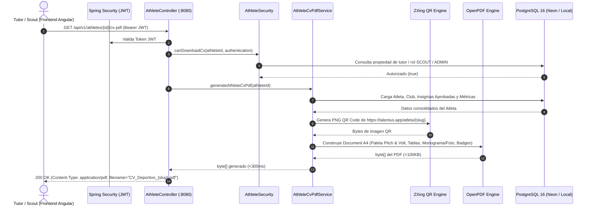

# Plan de Implementación: [TS-10] Generador de Hoja de Vida Deportiva (CV en PDF) en 1 Clic

**ID Tarea:** TS-10  
**Título Trello:** `[TS-10] Generador de Hoja de Vida Deportiva (CV en PDF) en 1 Clic`  
**Tarjeta Trello:** [https://trello.com/c/4pc2IP9T](https://trello.com/c/4pc2IP9T) (ID: `6abbe1f89f9d40580bd9caa2`)  
**Fecha:** 7 de octubre de 2026  
**Sprint:** Sprint 2 — Multimedia, Perfil Público y Verificación  
**Estado del Plan:** LISTO PARA IMPLEMENTACIÓN  
**Agente Planificador:** `trello_planner`  
**Agente Asignado para Ejecución:** `trello_implementer`  

---

## 1. Contexto de Negocio y Justificación

### 1.1. El Problema en el Fútbol Formativo
En Venezuela y Latinoamérica, cuando un joven futbolista asiste a pruebas presenciales (*tryouts*), visorías de clubes profesionales, convocatorias de selecciones estatales/nacionales o citas consulares de visado deportivo, los representantes y entrenadores suelen llevar carpetas físicas desactualizadas o documentos Word/PDF mal formateados, sin diseño profesional y sin forma de verificar la autenticidad de los datos deportivos y audiovisuales.

### 1.2. La Solución Talentus Scout: CV Deportivo en 1 Clic
Generación dinámica y en tiempo real de una **Ficha Técnica Deportiva Oficial (Curriculum Vitae)** en formato PDF A4 de una página, estéticamente diseñada bajo la identidad visual de alto rendimiento de Talentus Scout.
* **Valor Inmediato Día 1:** El tutor legal o scout acreditado puede descargar el CV en menos de 500ms listo para imprimir o enviar por correo/WhatsApp.
* **Integración Phygital con Código QR:** El documento PDF incorpora un código QR escaneable generado dinámicamente con alta resolución (ZXing) que apunta directamente al perfil público interactivo del atleta (`https://talentus.app/atleta/{slug}`). Esto permite que cualquier visor o cónsul que sostenga la hoja impresa pueda escanearla con su smartphone y ver instantáneamente los videos de jugadas en streaming HLS y las certificaciones oficiales.
* **Protección Legal LOPNNA (Art. 65) y Salvaguarda FIFA:**
  * El documento resguarda la privacidad del menor: **NO** se imprimen números telefónicos personales ni correos directos del niño/adolescente.
  * El contacto se canaliza formalmente a través del tutor legal verificado y club afiliado en la plataforma, y mediante el enlace seguro codificado en el QR.

---

## 2. Alcance Técnico y Arquitectura



### 2.1. Componentes del Sistema Involucrados
1. **Backend (`talentus-scout-be`):**
   * Incorporación de dependencias `com.github.librepdf:openpdf:2.0.3` y `com.google.zxing:core:3.5.3` / `javase:3.5.3` en `pom.xml`.
   * Servicio `AthleteCvPdfService`: ensamblado de documento A4 OpenPDF con diseño gráfico atlético, paleta intencional, tablas estructuradas y renderizado de código QR con ZXing.
   * Regla de seguridad en `AthleteSecurity`: método `canDownloadCv(UUID athleteId, Authentication authentication)` para autorizar al tutor dueño, scouts autenticados o administradores.
   * Endpoint en `AthleteController`: `GET /api/v1/athletes/{id}/cv-pdf` retornando `ResponseEntity<byte[]>`.
2. **Frontend (`talentus-scout-fe`):**
   * Servicio `AthleteService`: método `downloadAthleteCvPdf(athleteId: string): Observable<Blob>`.
   * `TutorDashboardComponent`: botón "Descargar CV (PDF)" en cada tarjeta de atleta con spinner de carga y descarga directa de archivo.
   * `BentoProfileComponent`: botón "Descargar CV Oficial" en la barra de acciones flotante y cabecera del perfil; si el usuario no ha iniciado sesión, despliega aviso modal/toast invitando al scout o tutor a autenticarse.

---

## 3. Modelo de Datos y Migraciones (PostgreSQL / Neon)

> [!NOTE]
> **No se requieren migraciones DDL adicionales.**
> El esquema de base de datos actual (`athletes`, `clubs_organizations`, `athlete_badges`, `users`) ya contiene todos los atributos deportivos requeridos para el CV: nombres, fecha de nacimiento, posición principal/secundaria, pierna hábil, biotipo (altura, peso), nacionalidad, pasaportes secundarios, licencia federativa, bio, slug e insignias verificadas.

---

## 4. Backend: Spring Boot 3 (Java 21)

### 4.1. Dependencias en `talentus-scout-be/pom.xml`
Se incorporan las librerías oficiales de generación de PDF libre y códigos QR:

```xml
<!-- OpenPDF: Generación de documentos PDF ultra-ligera y sin licencias privativas -->
<dependency>
    <groupId>com.github.librepdf</groupId>
    <artifactId>openpdf</artifactId>
    <version>2.0.3</version>
</dependency>

<!-- ZXing: Generación de códigos QR de alta densidad -->
<dependency>
    <groupId>com.google.zxing</groupId>
    <artifactId>core</artifactId>
    <version>3.5.3</version>
</dependency>
<dependency>
    <groupId>com.google.zxing</groupId>
    <artifactId>javase</artifactId>
    <version>3.5.3</version>
</dependency>
```

### 4.2. Seguridad: Actualización de `AthleteSecurity.java`
* **Archivo:** `talentus-scout-be/src/main/java/com/talentus/scout/security/AthleteSecurity.java`
* **Método a agregar:** `canDownloadCv(UUID athleteId, Authentication authentication)`
  * Permite la descarga si:
    1. El usuario autenticado es `ROLE_ADMIN`.
    2. El usuario autenticado es `ROLE_SCOUT`.
    3. El usuario autenticado es el `TUTOR` propietario del atleta (`isOwner(athleteId, authentication)`).

```java
@Transactional(readOnly = true)
public boolean canDownloadCv(UUID athleteId, Authentication authentication) {
    if (authentication == null || !authentication.isAuthenticated() || athleteId == null) {
        return false;
    }
    boolean isPrivileged = authentication.getAuthorities().stream()
            .anyMatch(a -> a.getAuthority().equals("ROLE_ADMIN") || a.getAuthority().equals("ROLE_SCOUT"));
    if (isPrivileged) {
        return true;
    }
    return isOwner(athleteId, authentication);
}
```

### 4.3. Servicio de Generación de PDF: `AthleteCvPdfService.java`
* **Archivo:** `talentus-scout-be/src/main/java/com/talentus/scout/service/pdf/AthleteCvPdfService.java`
* **Anotaciones:** `@Service`
* **Diseño Visual de la Ficha en OpenPDF:**
  * **Página:** `PageSize.A4` con márgenes limpios de 28pt.
  * **Paleta de Colores Intencional:**
    * Primario Fondo/Texto Oscuro: Pitch Slate `Color(15, 23, 42)` (`#0F172A`)
    * Acento Deportivo: Emerald Volt `Color(16, 185, 129)` (`#10B981`)
    * Acento de Certificación: Gold Amber `Color(217, 119, 6)` (`#D97706`)
    * Fondos de Tabla/Contenedores: Ice Neutral `Color(248, 250, 252)` (`#F8FAFC`)
    * Bordes Sutiles: Slate Border `Color(226, 232, 240)` (`#E2E8F0`)
    * Texto Secundario: Slate Muted `Color(100, 116, 139)` (`#64748B`)
  * **Estructura del Documento:**
    1. **Encabezado Superior (Header Bar):**
       * Banner con fondo oscuro `#0F172A`.
       * Título: `TALENTUS SCOUT • FICHA TÉCNICA OFICIAL`.
       * Subtítulo: `Curriculum Vitae Deportivo Certificado • Categorías Formativas`.
       * Chip dorado a la derecha: `DOCUMENTO VERIFICADO`.
    2. **Bloque Principal (Hero & Perfil):**
       * Columna Izquierda: Monograma deportivo estilizado o avatar con iniciales y color distintivo + Nombre completo en negrita (`Font.BOLD`, 18pt), Edad calculada (`X años`), Año de nacimiento, Posición principal y pierna hábil en chip verde esmeralda.
       * Columna Derecha: Contenedor con Código QR generado con ZXing (110x110 px), centrado, apuntando a `https://talentus.app/atleta/{slug}`, con leyenda: *"Escanear para ver Perfil Interactivo y Videos de Jugadas en Streaming"*.
    3. **Tabla de Datos Técnicos y Biotipo:**
       * Matriz estilizada de 2 columnas / 4 filas con bordes limpios:
         * Posición Principal / Posición Secundaria
         * Pie Hábil / Altura y Peso (ej. `175 cm / 68 kg`)
         * Nacionalidad / Pasaportes Secundarios (ej. `Comunitario UE / Español`)
         * Club Actual / Categoría formativa
         * Licencia Federativa Oficial (con número o estado)
    4. **Sección de Insignias y Certificaciones Oficiales:**
       * Lista de sellos aprobados (`AthleteBadge` con `status = APPROVED`), indicando la organización certificadora y fecha de emisión.
       * Si no posee badges en BD pero tiene licencia federativa o club activo, muestra las insignias institucionales correspondientes.
    5. **Resumen y Perfil Táctico (Bio):**
       * Párrafo descriptivo de las virtudes técnicas, perfil competitivo y rol en el campo del atleta.
    6. **Pie de Página Legal LOPNNA (Art. 65):**
       * Nota legal obligatoria:
         > *"Documento expedido exclusivamente para fines deportivos, scouting y convocatorias formativas. Queda prohibida la divulgación no autorizada de datos de contacto de menores de edad. Canal de contacto seguro gestionado a través de tutor legal y club verificado en Talentus Scout."*
       * Fecha y hora exacta de emisión + Identificador único del reporte.

### 4.4. Endpoint en `AthleteController.java`
* **Endpoint:** `GET /api/v1/athletes/{id}/cv-pdf`
* **Seguridad:** `@PreAuthorize("@athleteSecurity.canDownloadCv(#id, authentication)")`
* **Headers de Respuesta:**
  * `Content-Type`: `application/pdf`
  * `Content-Disposition`: `inline; filename="CV_Deportivo_{slug}.pdf"`
  * `Cache-Control`: `no-cache, no-store, must-revalidate`
* **Código de Respuesta:** `200 OK` (o `404 Not Found` si el atleta no existe, `403 Forbidden` si el usuario no tiene permisos).

---

## 5. Frontend: Angular 18+ (Standalone)

### 5.1. Actualización de `AthleteService`
* **Archivo:** `talentus-scout-fe/src/app/core/services/athlete.service.ts`
* **Método a agregar:**
```typescript
downloadAthleteCvPdf(athleteId: string): Observable<Blob> {
  return this.http.get(`${this.apiUrl}/${athleteId}/cv-pdf`, {
    responseType: 'blob'
  });
}
```

### 5.2. Integración en `TutorDashboardComponent`
* **Archivo:** `talentus-scout-fe/src/app/features/dashboard/tutor-dashboard.component.ts`
* **Acción UI:**
  * En la lista de atletas del tutor (`.athlete-card .athlete-actions`), incorporar el botón:
    ```html
    <button class="btn btn-secondary btn-sm" (click)="downloadCv(athlete)" [disabled]="isDownloadingCv(athlete.id)">
      <svg class="btn-icon" viewBox="0 0 24 24" fill="none" stroke="currentColor" stroke-width="2">
        <path d="M14 2H6a2 2 0 0 0-2 2v16a2 2 0 0 0 2 2h12a2 2 0 0 0 2-2V8z"></path>
        <polyline points="14 2 14 8 20 8"></polyline>
        <line x1="16" y1="13" x2="8" y2="13"></line>
        <line x1="16" y1="17" x2="8" y2="17"></line>
        <polyline points="10 9 9 9 8 9"></polyline>
      </svg>
      <span>{{ isDownloadingCv(athlete.id) ? 'Generando...' : 'Descargar CV' }}</span>
    </button>
    ```
  * Método TypeScript: `downloadCv(athlete: AthleteSummary)` maneja la descarga creando un `URL.createObjectURL(blob)` y un elemento `<a>` temporal con `download="CV_Deportivo_${athlete.slug}.pdf"`.

### 5.3. Integración en `BentoProfileComponent`
* **Archivo:** `talentus-scout-fe/src/app/features/public-profile/bento-profile.component.html` y `.ts`
* **Acción UI:**
  * En la barra flotante inferior (`.floating-share-dock .share-actions`), agregar el botón:
    ```html
    <button (click)="downloadCvPdf()" class="btn-pdf-action" [disabled]="isDownloadingCv">
      <svg class="pdf-icon" viewBox="0 0 24 24" fill="none" stroke="currentColor" stroke-width="2">
        <path d="M14 2H6a2 2 0 0 0-2 2v16a2 2 0 0 0 2 2h12a2 2 0 0 0 2-2V8z"></path>
        <polyline points="14 2 14 8 20 8"></polyline>
        <line x1="12" y1="18" x2="12" y2="12"></line>
        <polyline points="9 15 12 18 15 15"></polyline>
      </svg>
      <span>{{ isDownloadingCv ? 'Generando PDF...' : 'Ficha Técnica (PDF)' }}</span>
    </button>
    ```
  * Lógica de Permisos: Si el usuario está autenticado, descarga directamente el PDF vía `athleteService.downloadAthleteCvPdf(athlete.id)`. Si no está autenticado, muestra una notificación elegante informando que para descargar la Ficha Oficial para visorías y pruebas debe iniciar sesión con cuenta de Scout o Representante Legal, con botón de acceso.

---

## 6. Plan de Pruebas y Validación

### 6.1. Pruebas Unitarias del Backend (`talentus-scout-be`)
1. **`AthleteCvPdfServiceTest.java`**:
   * Verifica la generación correcta de bytes de PDF (`byte[]` no nulo, tamaño > 1KB y < 300KB).
   * Verifica que la cabecera del documento comience con la firma de formato `%PDF-`.
   * Verifica que el generador de código QR ZXing genere una imagen válida sin excepciones.
   * Verifica el cálculo de edad y formateo de datos deportivos cuando hay datos opcionales nulos (peso, altura, bio, club).
2. **`AthleteControllerTest.java`**:
   * `GET /api/v1/athletes/{id}/cv-pdf` con usuario no autenticado -> Retorna `401 Unauthorized` o `403 Forbidden`.
   * `GET /api/v1/athletes/{id}/cv-pdf` con tutor dueño del atleta -> Retorna `200 OK` con `Content-Type: application/pdf`.
   * `GET /api/v1/athletes/{id}/cv-pdf` con usuario no propietario sin rol privilegiado -> Retorna `403 Forbidden`.
   * `GET /api/v1/athletes/{id}/cv-pdf` con rol `ROLE_SCOUT` o `ROLE_ADMIN` -> Retorna `200 OK`.

### 6.2. Comandos de Verificación Manual (cURL)
```bash
# 1. Login como tutor para obtener Bearer token
TUTOR_TOKEN=$(curl -s -X POST http://localhost:8080/api/v1/auth/login \
  -H "Content-Type: application/json" \
  -d '{"email":"carlos.perez@talentus.test","password":"Password123!"}' | jq -r '.token')

# 2. Descargar PDF del atleta como tutor
curl -s -X GET http://localhost:8080/api/v1/athletes/00000000-0000-0000-0000-000000000001/cv-pdf \
  -H "Authorization: Bearer $TUTOR_TOKEN" \
  --output test_cv_atleta.pdf

# 3. Validar cabecera y peso del PDF generado
head -n 1 test_cv_atleta.pdf # Debe contener %PDF-
ls -lh test_cv_atleta.pdf     # Debe ser < 300KB (típicamente ~40KB - 80KB)
```

---

## 7. Checklist Paso a Paso (Para `trello_implementer`)

- [x] **Paso 1: Dependencias Maven**
  - Agregar `openpdf` (2.0.3) y `zxing` (core y javase 3.5.3) a `talentus-scout-be/pom.xml`.
  - Validar compilación limpia con `./mvnw clean compile`.
- [x] **Paso 2: Regla de Seguridad en `AthleteSecurity`**
  - Agregar método `canDownloadCv(UUID athleteId, Authentication authentication)`.
- [x] **Paso 3: Servicio de Generación de PDF (`AthleteCvPdfService`)**
  - Crear clase en paquete `com.talentus.scout.service.pdf`.
  - Implementar método para generar código QR en memoria (`generateQrCodeBytes(String url, int width, int height)`).
  - Implementar maquetado de ficha deportiva con OpenPDF:
    - Cabecera deportiva Slate `#0F172A`.
    - Hero con monograma, nombre, edad y código QR con enlace interactivo.
    - Cuadrícula de datos técnicos y biotipo.
    - Bloque de insignias verificadas.
    - Pie legal LOPNNA Art. 65.
- [x] **Paso 4: Endpoint REST en `AthleteController`**
  - Agregar `GET /api/v1/athletes/{id}/cv-pdf` protegido por `@PreAuthorize("@athleteSecurity.canDownloadCv(#id, authentication)")`.
  - Configurar headers `Content-Type: application/pdf` y `Content-Disposition`.
- [x] **Paso 5: Pruebas Automatizadas Backend**
  - Crear prueba unitaria `AthleteCvPdfServiceTest.java`.
  - Ejecutar `./mvnw test` y validar que todos los tests pasen al 100%.
- [x] **Paso 6: Frontend - Integración en Servicio Angular**
  - Agregar método `downloadAthleteCvPdf(athleteId: string)` en `athlete.service.ts`.
- [x] **Paso 7: Frontend - Botón de Descarga en `TutorDashboardComponent`**
  - Agregar botón con icono de documento PDF en la tarjeta de atleta.
  - Implementar método para disparar la descarga directa del blob.
- [x] **Paso 8: Frontend - Botón de Descarga en `BentoProfileComponent`**
  - Agregar botón "Ficha Técnica (PDF)" en la barra de acciones flotante.
  - Si el usuario está autenticado, descargar; si no, mostrar diálogo/aviso de autenticación.
- [x] **Paso 9: Pruebas Automatizadas Frontend**
  - Ejecutar pruebas en Angular con `npm test -- --watch=false` o validar compilación con `npm run build`.
- [x] **Paso 10: Generación del Plan de Pruebas y Finalización**
  - Redactar documento de pruebas en `test/TS-10-test-plan-generador-cv-pdf.md`.
  - Mover la tarjeta TS-10 en Trello de `in development` a `in testing` y publicar comentario de entrega.

---

## 8. Criterios de Aceptación (Definition of Done - DoD)

1. [x] **Tiempo de Generación:** El PDF se genera en el backend en menos de 500ms (típicamente < 100ms con OpenPDF).
2. [x] **Peso del Archivo:** El PDF resultante pesa menos de 300KB (optimizado en ~40KB - 80KB).
3. [x] **Código QR Escaneable:** El código QR renderizado en el documento es 100% nítido, legible y al ser escaneado abre la URL del perfil público del atleta (`https://talentus.app/atleta/{slug}`).
4. [x] **Protección LOPNNA:** El PDF no expone datos de contacto privados del menor de edad e incluye el descargo legal explícito del Art. 65.
5. [x] **Compilación y Tests:** `./mvnw clean test` y `npm run build` ejecutan sin errores de compilación ni fallos.
