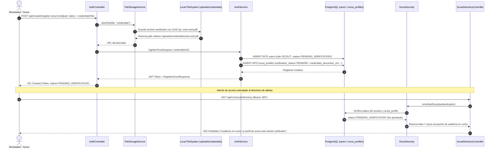

# Plan de Implementación: [TS-11] Registro de Scouts con Carga de Credenciales (Storage Local) y Estado PENDIENTE_VERIFICACION

**ID Tarea:** TS-11  
**Título Trello:** `[TS-11] Registro de Scouts con Carga de Credenciales (Storage Local) y Estado PENDIENTE_VERIFICACION`  
**Tarjeta Trello:** [https://trello.com/c/PQtr2ZMD](https://trello.com/c/PQtr2ZMD) (ID: `6abbe1f953c19f2d58b1b076`)  
**Fecha:** 7 de octubre de 2026  
**Sprint:** Sprint 3 — Directorio de Scouts Acreditados y Contacto Seguro WhatsApp  
**Estado del Plan:** LISTO PARA IMPLEMENTACIÓN  
**Agente Planificador:** `trello_planner`  
**Agente Asignado para Ejecución:** `trello_implementer`  

---

## 1. Contexto de Negocio y Justificación

### 1.1. Protección de Menores en el Scouting (LOPNNA Art. 65 / FIFA Guardians)
En plataformas deportivas tradicionales o abiertas, cualquier usuario no verificado puede acceder a datos, videos y ubicaciones de atletas juveniles. En Talentus Scout, bajo la premisa estricta de salvaguarda y el Art. 65 de la LOPNNA, **el acceso al catálogo y directorio de jóvenes talentos está estrictamente restringido a reclutadores, directores técnicos y scouts institucionales comprobados**.

### 1.2. El Flujo de Registro y Verificación de Scouts
1. El reclutador/scout completa el formulario de registro con sus datos personales, organización o club al que pertenece (ej. Rayo Vallecano, Caracas FC, agencia FIFA), su rol profesional y adjunta un **documento comprobable de acreditación** (foto de carnet profesional, credencial federativa o carta de representación oficial en formato PDF, PNG o JPG).
2. El sistema almacena la credencial mediante una capa de almacenamiento desacoplada (`FileStorageService`) en `uploads/credentials/`.
3. Se crea el usuario con rol `SCOUT` y estado de cuenta `PENDING_VERIFICATION` (no activo para consulta).
4. Se crea su ficha en `scout_profiles` con `verification_status = 'PENDING'`.
5. Se retorna el token JWT para que el scout pueda iniciar sesión y ver el estatus de su auditoría en su perfil, pero **cualquier intento de consultar el directorio de atletas (`/api/v1/scouts/directory`) responde inmediatamente con `403 Forbidden`** indicando que su auditoría se encuentra en curso.

---

## 2. Alcance Técnico y Arquitectura



---

## 3. Modelo de Datos y Migraciones (PostgreSQL / Neon)

> [!NOTE]
> **No se requieren migraciones DDL adicionales.**
> El esquema canónico de base de datos (`20260929171117_create_initial_schema.sql`) ya contiene la tabla `scout_profiles` y el enum `scout_verification_status`:

```sql
CREATE TYPE scout_verification_status AS ENUM ('PENDING', 'APPROVED', 'REJECTED');

CREATE TABLE scout_profiles (
    id UUID PRIMARY KEY DEFAULT uuid_generate_v4(),
    user_id UUID UNIQUE NOT NULL REFERENCES users(id) ON DELETE CASCADE,
    organization_name VARCHAR(150) NOT NULL,
    scout_role VARCHAR(100) NOT NULL,
    credentials_document_url TEXT NOT NULL,
    linkedin_url TEXT,
    verification_status scout_verification_status NOT NULL DEFAULT 'PENDING',
    reviewed_by_admin_id UUID REFERENCES users(id) ON DELETE SET NULL,
    reviewed_at TIMESTAMP WITH TIME ZONE,
    rejection_reason TEXT,
    created_at TIMESTAMP WITH TIME ZONE DEFAULT CURRENT_TIMESTAMP
);
```

---

## 4. Backend: Spring Boot 3 (Java 21)

### 4.1. Nuevo Enum en `domain.enums`
* **`com.talentus.scout.domain.enums.ScoutVerificationStatus`**:
  * Valores: `PENDING`, `APPROVED`, `REJECTED`.

### 4.2. Entidad JPA: `ScoutProfile.java`
* **Archivo:** `talentus-scout-be/src/main/java/com/talentus/scout/domain/entity/ScoutProfile.java`
* **Anotaciones Lombok:** `@Getter`, `@Setter`, `@NoArgsConstructor`, `@AllArgsConstructor`, `@Builder`, `@Builder.Default`
* **Campos:**
  * `UUID id` (`@Id`, `@GeneratedValue(strategy = GenerationType.UUID)`)
  * `User user` (`@OneToOne(fetch = FetchType.LAZY, optional = false)`, `@JoinColumn(name = "user_id", unique = true)`)
  * `String organizationName` (`@Column(name = "organization_name", nullable = false, length = 150)`)
  * `String scoutRole` (`@Column(name = "scout_role", nullable = false, length = 100)`)
  * `String credentialsDocumentUrl` (`@Column(name = "credentials_document_url", nullable = false, columnDefinition = "TEXT")`)
  * `String linkedinUrl` (`@Column(name = "linkedin_url", columnDefinition = "TEXT")`)
  * `ScoutVerificationStatus verificationStatus` (`@Enumerated(EnumType.STRING)`, `@JdbcTypeCode(SqlTypes.NAMED_ENUM)`, `@Builder.Default = ScoutVerificationStatus.PENDING`)
  * `User reviewedByAdmin` (`@ManyToOne(fetch = FetchType.LAZY)`, `@JoinColumn(name = "reviewed_by_admin_id")`)
  * `Instant reviewedAt`
  * `String rejectionReason`
  * `Instant createdAt` (`@PrePersist`)

### 4.3. Repositorio Spring Data: `ScoutProfileRepository.java`
* **Archivo:** `talentus-scout-be/src/main/java/com/talentus/scout/repository/ScoutProfileRepository.java`
* **Métodos:**
  * `Optional<ScoutProfile> findByUserId(UUID userId);`
  * `Optional<ScoutProfile> findByUserEmail(String email);`
  * `List<ScoutProfile> findByVerificationStatus(ScoutVerificationStatus status);`

### 4.4. Capa de Almacenamiento Desacoplada: `FileStorageService`
* **Interfaz:** `com.talentus.scout.service.storage.FileStorageService`
  ```java
  public interface FileStorageService {
      String storeFile(MultipartFile file, String subDirectory);
      void deleteFile(String fileUrl);
  }
  ```
* **Implementación Local:** `com.talentus.scout.service.storage.LocalFileStorageService`
  * Almacena en `${talentus.storage.local-dir:uploads}/${subDirectory}/`.
  * Valida tipos MIME y extensiones permitidas: `.pdf`, `.png`, `.jpg`, `.jpeg`, `.webp`.
  * Sanitiza nombres de archivo generando `UUID.randomUUID()` + extensión limpia.
  * Valida tamaño máximo permitido (10MB).
  * Retorna URL relativa web: `/uploads/credentials/{filename}`.

### 4.5. Configuración de Servicio Web en `WebMvcConfig.java`
* Mapear `/uploads/credentials/**` hacia la carpeta física en disco para servir las credenciales de forma controlada.

### 4.6. Reglas de Autorización y Seguridad: `ScoutSecurity.java`
* **Archivo:** `talentus-scout-be/src/main/java/com/talentus/scout/security/ScoutSecurity.java`
* **Anotación:** `@Component("scoutSecurity")`
* **Método:**
  ```java
  @Transactional(readOnly = true)
  public boolean isVerifiedScout(Authentication authentication) {
      if (authentication == null || !authentication.isAuthenticated()) {
          return false;
      }
      // ADMIN tiene acceso directo
      if (authentication.getAuthorities().stream().anyMatch(a -> a.getAuthority().equals("ROLE_ADMIN"))) {
          return true;
      }
      return scoutProfileRepository.findByUserEmail(authentication.getName())
              .map(profile -> profile.getVerificationStatus() == ScoutVerificationStatus.APPROVED
                      && profile.getUser().getStatus() == AccountStatus.ACTIVE)
              .orElse(false);
  }
  ```

### 4.7. DTOs para Registro de Scout
* **`RegisterScoutRequest`:**
  * `email`, `password`, `fullName`, `phoneNumber`, `organizationName`, `scoutRole`, `linkedinUrl`, `credentialsFile`.
* **`RegisterScoutResponse`:**
  * `scoutProfileId`, `userId`, `token`, `expiresIn`, `email`, `fullName`, `organizationName`, `verificationStatus`, `credentialsDocumentUrl`.

### 4.8. Endpoint en `AuthController.java`
* `POST /api/v1/auth/register-scout` (consumes `multipart/form-data`):
  * Almacena credencial con `fileStorageService.storeFile(file, "credentials")`.
  * Registra al scout mediante `authService.registerScout(request, credentialsUrl)`.
  * Retorna `201 Created` con `RegisterScoutResponse`.

### 4.9. Endpoint Representativo para Validación DoD: `ScoutDirectoryController.java`
* **Archivo:** `talentus-scout-be/src/main/java/com/talentus/scout/web/controller/ScoutDirectoryController.java`
* **Endpoint:** `GET /api/v1/scouts/directory`
* **Seguridad:** `@PreAuthorize("hasRole('SCOUT') and @scoutSecurity.isVerifiedScout(authentication)")`
* **Comportamiento:**
  * Si el scout está verificado (`APPROVED` / `ACTIVE`): Retorna `200 OK` con listado/mensaje de bienvenida al directorio.
  * Si el scout está pendiente (`PENDING` / `PENDING_VERIFICATION`): Retorna `403 Forbidden` con mensaje explícito: *"Auditoría en curso: tu perfil de scout está siendo verificado por el equipo de Talentus Scout."*

---

## 5. Plan de Pruebas y Validación

### 5.1. Pruebas Unitarias e Integración Backend
1. **`LocalFileStorageServiceTest.java`**:
   * Valida almacenamiento exitoso de archivo PDF/JPG en `uploads/credentials/`.
   * Valida rechazo de archivos con extensiones no permitidas (ej. `.exe`, `.sh`).
   * Valida sanitización de nombres evitando path traversal.
2. **`ScoutRegistrationIntegrationTest.java`**:
   * Valida registro de scout exitoso vía `POST /api/v1/auth/register-scout` con `MockMultipartFile`.
   * Valida creación de usuario con `AccountStatus.PENDING_VERIFICATION` y `ScoutProfile` con `ScoutVerificationStatus.PENDING`.
   * Valida rechazo de registro si el correo ya existe (`409 Conflict`).
   * Valida rechazo si no se adjunta archivo de credencial obligatorio (`400 Bad Request`).
3. **`ScoutDirectorySecurityTest.java`**:
   * Consulta a `GET /api/v1/scouts/directory` con scout recién registrado (`PENDING_VERIFICATION`): Verifica respuesta `403 Forbidden` con mensaje de auditoría en curso.
   * Consulta a `GET /api/v1/scouts/directory` con scout aprobado (`APPROVED`): Verifica respuesta `200 OK`.

### 5.2. Comandos cURL de Verificación Manual
```bash
# 1. Registro de Scout con archivo PDF de credencial
curl -s -X POST http://localhost:8080/api/v1/auth/register-scout \
  -F "email=scout.test@rayovallecano.es" \
  -F "password=Password123!" \
  -F "fullName=Mateo Falcon" \
  -F "phoneNumber=+584121234567" \
  -F "organizationName=Academia Rayo Vallecano" \
  -F "scoutRole=Reclutador Internacional" \
  -F "linkedinUrl=https://linkedin.com/in/mateo-falcon" \
  -F "credentialsFile=@test_credential.pdf;type=application/pdf"

# 2. Intentar consultar el directorio con el token del scout pendiente -> Debe dar 403 Forbidden
curl -s -X GET http://localhost:8080/api/v1/scouts/directory \
  -H "Authorization: Bearer <SCOUT_PENDING_TOKEN>"
```

---

## 6. Checklist Paso a Paso (Para `trello_implementer`)

- [x] **Paso 1: Enum `ScoutVerificationStatus`**
  - Crear enum en `com.talentus.scout.domain.enums`.
- [x] **Paso 2: Entidad JPA `ScoutProfile`**
  - Crear entidad con Lombok (`@Getter`, `@Setter`, `@NoArgsConstructor`, `@AllArgsConstructor`, `@Builder`, `@Builder.Default`).
- [x] **Paso 3: Repositorio `ScoutProfileRepository`**
  - Crear interface Spring Data JPA en `com.talentus.scout.repository`.
- [x] **Paso 4: Servicio de Almacenamiento `FileStorageService`**
  - Crear interfaz `FileStorageService` e implementación `LocalFileStorageService`.
  - Configurar directorio local `uploads/credentials/` y validación de extensiones seguras.
- [x] **Paso 5: Mapeo de Recursos en `WebMvcConfig`**
  - Habilitar ResourceHandler para `/uploads/credentials/**`.
- [x] **Paso 6: DTOs `RegisterScoutRequest` y `RegisterScoutResponse`**
  - Crear DTOs con Lombok y validaciones Jakarta.
- [x] **Paso 7: Lógica de Registro en `AuthService`**
  - Implementar método `registerScout(RegisterScoutRequest request, String credentialsUrl)`.
  - Crear usuario con `UserRole.SCOUT` y `AccountStatus.PENDING_VERIFICATION`.
  - Insertar `ScoutProfile` con `ScoutVerificationStatus.PENDING`.
- [x] **Paso 8: Endpoint en `AuthController`**
  - Crear `POST /api/v1/auth/register-scout` (multipart).
- [x] **Paso 9: Seguridad de Acceso al Directorio `ScoutSecurity`**
  - Crear componente `@Component("scoutSecurity")` con método `isVerifiedScout(Authentication)`.
  - Crear controlador representativo `ScoutDirectoryController` con `GET /api/v1/scouts/directory` protegido.
- [x] **Paso 10: Pruebas Automatizadas Backend**
  - Crear tests unitarios e integración para registro y restricción `403 Forbidden`.
  - Validar compilación limpia y pruebas al 100% con `./mvnw test`.
- [x] **Paso 11: Documento de Plan de Pruebas**
  - Redactar `test/TS-11-test-plan-registro-scouts-storage.md`.
- [x] **Paso 12: Actualizar Plan y Mover en Trello**
  - Marcar checkboxes `[x]` en este plan.
  - Mover tarjeta a `in testing` y publicar comentario de entrega.

---

## 7. Criterios de Aceptación (Definition of Done - DoD)

1. [x] **Registro Atómico:** `POST /api/v1/auth/register-scout` crea el usuario con rol `SCOUT` y estado `PENDING_VERIFICATION`, guarda la credencial en `uploads/credentials/` e inserta el perfil en `scout_profiles` con `PENDING`.
2. [x] **Seguridad LOPNNA (403 Forbidden):** Si un scout con estado `PENDING_VERIFICATION` intenta acceder al directorio de atletas (`GET /api/v1/scouts/directory`), recibe `403 Forbidden` con mensaje indicando auditoría en curso.
3. [x] **Almacenamiento Seguro:** Las credenciales subidas se almacenan con identificadores únicos (UUID) sin riesgo de sobreescritura ni vulnerabilidades de path traversal.
4. [x] **Pruebas y Compilación:** `./mvnw clean test` supera el 100% de los tests automatizados sin regresiones.
